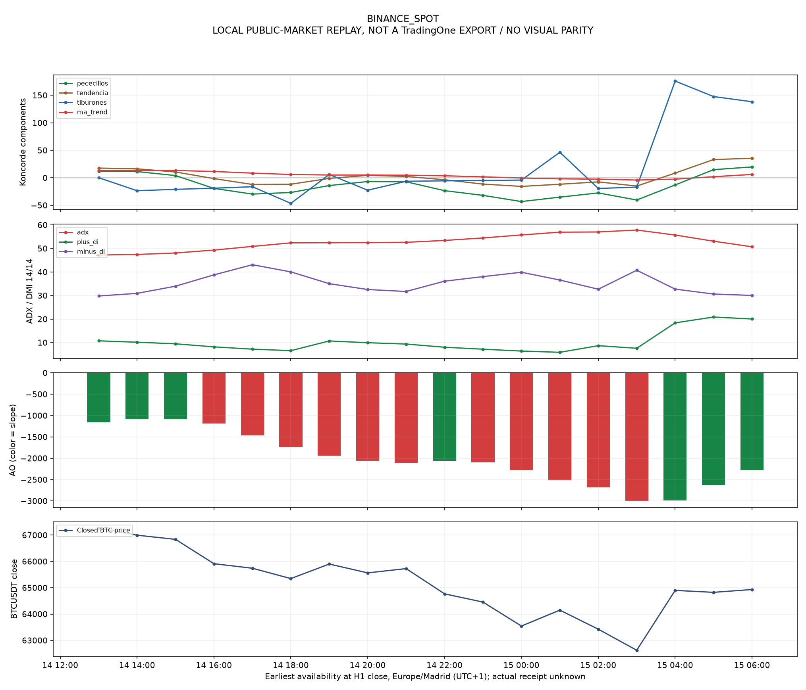

# I-GOD Confluencia H1: auditoría de identidad y giros

**Conclusión: INCONCLUSO. No se ha demostrado rentabilidad ni paridad externa.**

PR #46 y sus resultados permanecen intactos. Esta fase no ejecuta nuevos backtests,
no modifica indicadores y no cambia ninguna regla para capturar el 15/11/2026.
Las capturas constituyen un caso diagnóstico seleccionado retrospectivamente;
el histórico examinado no es un holdout virgen.

## Qué buscábamos y qué se programó

| Idea visual | Regla efectiva de PR #46 | Diferencia relevante |
|---|---|---|
| «Konkorde gira/cruza» | `tendencia` cruza EMA15(`tendencia`); valor previo <0 para LONG, >0 para SHORT | No usa `pececillos` ni `tiburones`. Giro de pendiente y paso por cero no equivalen a ese cruce. |
| ADX hace techo y baja | `ADX[t-1] < ADX[t-2]` y `ADX[t-2] > 40` | Descenso anterior desplazado una vela. No exige máximo local, ni descenso actual. |
| ADX hace suelo y sube | No existe esa condición | Un giro de fuerza al alza es un evento distinto; ADX no determina dirección. |
| AO negativo empieza a recuperarse | `AO[t] < 0` y `AO[t] > AO[t-1] > AO[t-2]` | Exige dos pendientes positivas, no la primera barra de recuperación. |
| AO positivo pierde impulso | `AO[t] > 0` y `AO[t] < AO[t-1] < AO[t-2]` | Dos pendientes negativas; no significa que AO ya sea negativo. |
| Expansión/volatilidad | BBWP >85 | Nivel alto no equivale a pendiente creciente ni a un giro de volatilidad. |
| DMI acompaña dirección | DMI se calcula, pero no interviene en la entrada | No se programó un requisito +DI/−DI. |
| Eventos próximos en el tiempo | Todas las condiciones deben ser verdaderas en la misma vela `t` | No se implementó una ventana que conserve eventos anteriores. |

Estos hechos explican por qué una imagen aparentemente favorable puede no
producir una señal de aquella regla. No prueban que sustituir una serie o añadir
una ventana vaya a mejorar los resultados.

## Series identificadas por el propio código original

Referencia byte-exacta heredada de PR #46:
`research/confluence_1h/reference_sources/koncorde_original.pine.txt`.
SHA256: `0ec23aff606373510eac925deb5f0d6f0182a73d5b97ec7a00a13ebabc063444`.

| Variable | Título original | Fórmula / relación |
|---|---|---|
| `tendencia` | Marron / Lmarron | `(RSI14(OHLC4) + MFI14(HLC3) + oscBB + SMA3(stoch21)/3)/2` |
| `pececillos` | Verde / Lineav | `tendencia + osc_pos` |
| `tiburones` | Azul / Lazul | `osc_neg` |
| `ma_trend` | Media, roja por defecto | EMA15 de **tendencia** |

`oscBB = 100*(OHLC4-SMA25(OHLC4))/(4*stdev25(OHLC4))`, desviación poblacional.
El stochastic utiliza OHLC4 dentro del máximo HIGH / mínimo LOW de 21 velas.
`osc_pos = 100*(PVI-EMA15(PVI))/(highest90(EMA15(PVI))-lowest90(EMA15(PVI)))`.
`osc_neg` aplica la misma normalización a NVI. PVI cambia si sube el volumen y
NVI si baja. La escala inicial multiplicativa cancela en esos cocientes; el
prefijo de precios/volumen, las semillas y la ventana histórica siguen importando.
Los cocientes indefinidos se mantienen no disponibles.

Por tanto, las áreas son series distintas y pueden producir cruces en velas
distintas. Los colores se configuran y las áreas se superponen: una tonalidad
amarillenta no identifica una variable. **No elegimos cuál constituye «la señal».**
La media roja no se sustituye por EMA(`pececillos`) ni EMA(`tiburones`).

## Semántica causal del nuevo diagnóstico

Solo se describen eventos; no se combinan como nuevas entradas.

* Cruce alcista frente a roja: `x[t] > ma[t]` y `x[t-1] <= ma[t-1]`.
  Cruce bajista: desigualdades inversas. Se calcula para las tres áreas.
* Giro de pendiente: cambio estricto negativa→positiva o positiva→negativa.
  Las mesetas de pendiente cero se etiquetan aparte, sin elegir retrospectivamente
  cuándo empieza un giro. El vértice queda en `t-1`, pero se conoce al cierre de `t`.
* Paso por cero: `x[t] >0` con `x[t-1] <=0`, o el inverso. Puede ocurrir sin cruzar
  la roja y sin invertir la pendiente en esa vela. Se calcula también para la roja.
* ADX desde máximos: pendiente previa >0 y actual <0. ADX desde mínimos: previa
  <0 y actual >0. Ninguna definición implica por sí sola LONG o SHORT.
* AO negativo: primera recuperación y dos barras ascendentes se registran por
  separado. AO positivo: primer deterioro y dos barras descendentes también.
* Cada evento incluye su antigüedad en cierres completos. No se escoge una ventana
  de coincidencia a partir de este caso, ni se calculan rendimientos posteriores.

Un evento conocido al cerrar una vela no puede ejecutarse retrospectivamente en
el vértice anterior. Los tiempos `time` y `time_close` representan apertura y cierre;
`timenow` corresponde al instante de ejecución del script, especialmente distinto
en histórico. Véase la documentación primaria de
[tiempos de Pine](https://www.tradingview.com/pine-script-docs/concepts/time/) y
[estado confirmado de una vela](https://www.tradingview.com/pine-script-docs/concepts/chart-information/).

## Diagnóstico del 15/11/2026, 01:00–05:00 Europe/Madrid

En esa fecha Madrid es UTC+1. «Vela de las 02:00» puede significar apertura
02:00→03:00 Madrid; sus indicadores finales solo están disponibles a las 03:00.
Si se habla de un cierre disponible a las 02:00, corresponde a la vela abierta
a las 01:00. No interpretamos una etiqueta de apertura como una señal ya conocida.

Los CSV cubren la unión de ambos significados: aperturas Madrid 00:00–05:00,
cierres Madrid 01:00–06:00. Los gráficos usan **cierre/disponibilidad mínima** en
su eje X; la recepción/emisión real histórica es desconocida.

Replay descriptivo USD-M, números redondeados aquí; CSV conserva precisión:

| Apertura Madrid | Cierre / disponibilidad mínima Madrid | pececillos | tendencia | ma_trend | tiburones | ADX | AO | Hecho descriptivo |
|---|---|---:|---:|---:|---:|---:|---:|---|
| 01:00 | 02:00 | −27.132 | −6.832 | −2.150 | −19.706 | 57.036 | −2684.850 | ADX aún sube; AO aún empeora |
| 02:00 | 03:00 | −40.235 | −14.658 | −3.713 | −17.243 | 57.898 | −3004.293 | Vértice ADX/AO solo identificable más tarde; tiburones recupera pendiente |
| 03:00 | 04:00 | −12.104 | 9.582 | −2.051 | 178.605 | 55.796 | −2990.101 | tendencia y tiburones cruzan roja/cero; pececillos cambia pendiente sin cruzar roja; ADX gira desde máximo; primera recuperación AO |
| 04:00 | 05:00 | 15.466 | 33.941 | 2.448 | 150.182 | 53.208 | −2623.674 | pececillos cruza roja/cero; segunda subida AO; ADX sigue bajando |

Con Spot se observan los mismos instantes de esos dos cruces principales, pero
los números son distintos: al cierre 04:00 Madrid, `tendencia=8.616524738463001`,
`pececillos=-12.965536557463833`, `ma_trend=-2.4837912410513345`; al cierre 05:00,
`pececillos=14.821005528850733`, `ma_trend=1.9780632627203358`.
No se fusionan venues ni se atribuye ninguna a la captura sin comprobar su ticker.

La secuencia local ilustra un problema de simultaneidad: el cruce de tendencia y
la primera recuperación AO aparecen a las 04:00; la condición de dos subidas AO
se conoce a las 05:00, cuando el cruce de tendencia ya no es nuevo. Cambiar a
pececillos podría desplazar un evento, pero **no se ha evaluado esa sustitución
como estrategia** ni se ha escogido para «rescatar» este rebote.

Los dos fixtures proceden de respuestas públicas REST de Binance reutilizadas
de PR #46; 1.805 velas H1 cerradas por venue, desde 01/09/2026 00:00 UTC hasta
15/11/2026 04:00 UTC inclusive. El último cierre es 05:00 UTC / 06:00 Madrid.
Los manifiestos documentan hashes de respuestas, parámetros y transformación a
OHLCV. No hay nueva descarga ni datos de trades, cuentas o Bitunix. Los hashes
son locales, no checksums certificados de archivo Binance. La hora original de
recepción HTTP no quedó atestiguada; se conserva esa limitación. El inicio del
histórico de la plataforma tampoco está confirmado: estos valores no constituyen
paridad externa aunque el warmup local sea amplio.

## Qué demuestra la auditoría independiente y qué no

ZIP recibido: `IGOD_auditoria_independiente.zip`, 20.105 bytes,
SHA256 `757330bbc908dfe65ab1c0d35f1fe42252d0ff4fe3d56819564d4dbf22580d8d`.
`independent_audit_manifest.json` registra todos sus miembros y hashes. Se conserva
su LEEME y salida como evidencia **suministrada**, sin volver a ejecutar sus
simulaciones. El driver es byte-idéntico al del ZIP inicial; no es el laboratorio
corregido completo de PR #46. El autor declara datos sintéticos, sin acceso al
repositorio ni descarga BTC: no es una réplica independiente de nuestros resultados.

| Material | Valor útil | Límite constatado al leer el código |
|---|---|---|
| audit1 | Referencias escalares de algunos cálculos | No compara pececillos/tiburones con plataforma. `ref_ema` siembra con SMA(n), distinto del primer valor válido de PR #46; una convergencia posterior no prueba misma inicialización. BBWP usa conteo inclusivo, diferente del índice derecho literal ante empates. |
| audit2 | Causalidad sintética y asimetría del filtro de signo | Umbrales relajados 25/60 para parte del ensayo. Las cotas de tendencia y rareza no son evidencia de rentabilidad. |
| audit3 | Embudo sintético y prefijos de señales | «identical entries» se calcula comparando cantidades, no identidad de todas las entradas/precios/resultados. Parte usa 15/20; no replica mercado real. |
| audit4 | Efecto potencial de costes y necesidad de muestra | Trades aleatorios sintéticos; escenarios no emparejan necesariamente las mismas entradas. Tarifas «realistas» no verificadas; no funding real. Fórmula binaria de equilibrio no cubre salidas temporales/gaps. |
| audit5 | Los filtros comparten información de precio/volumen | Correlaciones sintéticas contemporáneas no demuestran predicción futura ni independencia estadística. |

Las aproximaciones de potencia con muestras iid no incorporan dependencia temporal;
no constituyen un número mágico de trades que valide la estrategia. «Sin edge por
construcción» es la descripción del generador suministrado, no una prueba universal
sobre todas las reglas posibles bajo dinámica de volatilidad.

**No se cambian semillas, BBWP ni fórmulas de PR #46 a partir de estas diferencias.**
Se registran como diferencias de las referencias que requieren contraste externo.

## Paridad matemática y externa: estados separados

* Fórmulas públicas: se reutiliza `calculate` de PR #46 sin editar. Se contrasta
  tendencia con su referencia escalar anterior, y PVI/NVI/EMA/normalización con
  otro cálculo en bucle en los nuevos tests. Identidades y eventos tienen fixtures
  calculables y pruebas de invariancia por prefijo.
* Pine nuevo: cálculo diagnóstico de las tres áreas y roja, más logs de valores y
  tiempos. Lectura estática contrastada con las fórmulas; **compilación y ejecución
  de este archivo nuevo no realizadas**. No se presenta como Pine original de la
  plataforma ni como prueba numérica independiente.
* Exportaciones reales recibidas de TradingOne: **0**. Comparaciones reales
  Python/plataforma ejecutadas: **0**. Paridad externa: **NO VERIFICADA**.
* Paridad exacta con indicadores privados de Bitman: **NOT PROVEN**.

El comparador entrega errores máximos por campo, diferencias OHLCV, correspondencia
temporal, cruces y giros/pasos por cero. Con redondeo insuficiente un cruce puede
quedar indeterminado. No desplaza series para maximizar coincidencia. Las plantillas
son vacías, no registros sintéticos disfrazados de exportación.

## Siguiente especificación: aún no congelada

Se ha predeclarado un **protocolo de comparación**, no una nueva estrategia.
Mientras no esté comprobada la equivalencia y no se haya identificado el evento
visual, `coincidence_window`, `entry` e `invalidation` permanecen sin asignar.
Inventar ahora una ventana de 1–3 velas para capturar este caso sería escoger
reglas a partir del ejemplo conocido.

Para completar la identificación falta:

1. Exportación real con las tres áreas y la roja **identificadas por nombre**,
   OHLCV y velas anteriores; ticker/exchange/Spot o perpetuo y tipo de vela exactos.
2. Configuración original y prefijo de inicialización; timestamps con zona/offset
   y aclaración de apertura/cierre. Una reproducción local con el mismo nombre de
   indicador no identifica por sí sola el indicador usado en la captura.
3. Contraste externo y revisión de qué se describía visualmente: cruce, cambio de
   pendiente o paso por cero, incluyendo otros casos desfavorables seleccionados
   por tiempo, sin escogerlos por el beneficio posterior.

Después se podrá fijar **una sola especificación causal** con serie/evento,
ventana fija, orden de eventos, expiración, invalidación, entrada ejecutable
posterior, stop/salidas y costes/funding, antes de observar sus nuevos outcomes.
Solo entonces corresponderán pruebas de estrategia y controles emparejados por
régimen. Ninguna observación histórica ya examinada se llamará holdout virgen.

## Resultado y aislamiento

**INCONCLUSO. No hay autorización para volver a probar rentabilidad ni para operar.**
La auditoría estática ha avanzado sin esperar datos externos. No se ha decidido
que el cruce de pececillos sea el correcto. Tampoco se ha evaluado una variante
para transformar el resultado de PR #46.

Los tests nuevos comprueban tiempos, unidades, DST, valores indefinidos, eventos
separados, conservación de prefijos, errores del comparador e imposibilidad de
certificar paridad real con fixtures sintéticos. El guard exige que todos los
archivos anteriores de PR #46 y producción sigan intactos y que producción no
importe el laboratorio nuevo. Los resultados de suites y auditorías figuran en
`validation.json`; los scripts sintéticos de la auditoría adjunta no se ejecutan.

No se ha accedido a Railway ni Bitunix. No se envían órdenes ni Telegram. No se
modifican Guardian, V8, ML RSI, readiness, market-data, protocolos ni journals.
No merge. No deploy. SHADOW ONLY. TRADE AUTHORITY: NONE.
