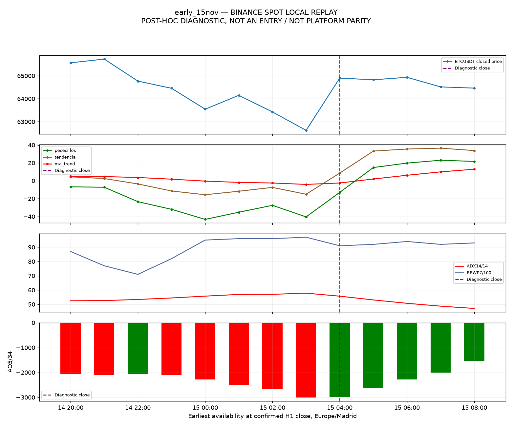
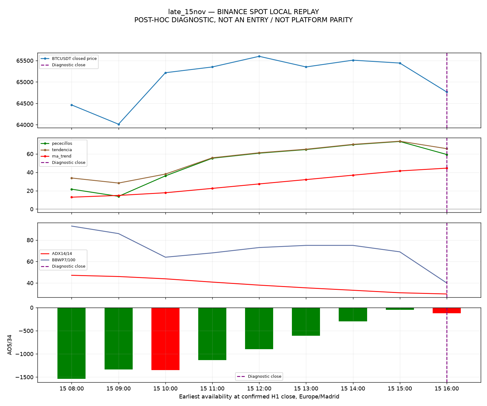
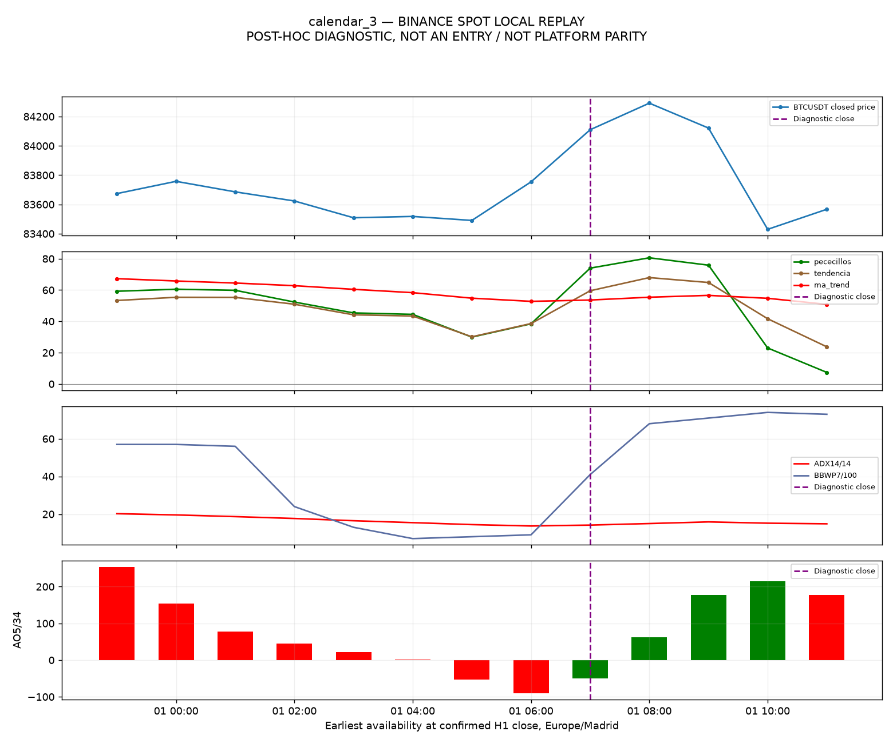
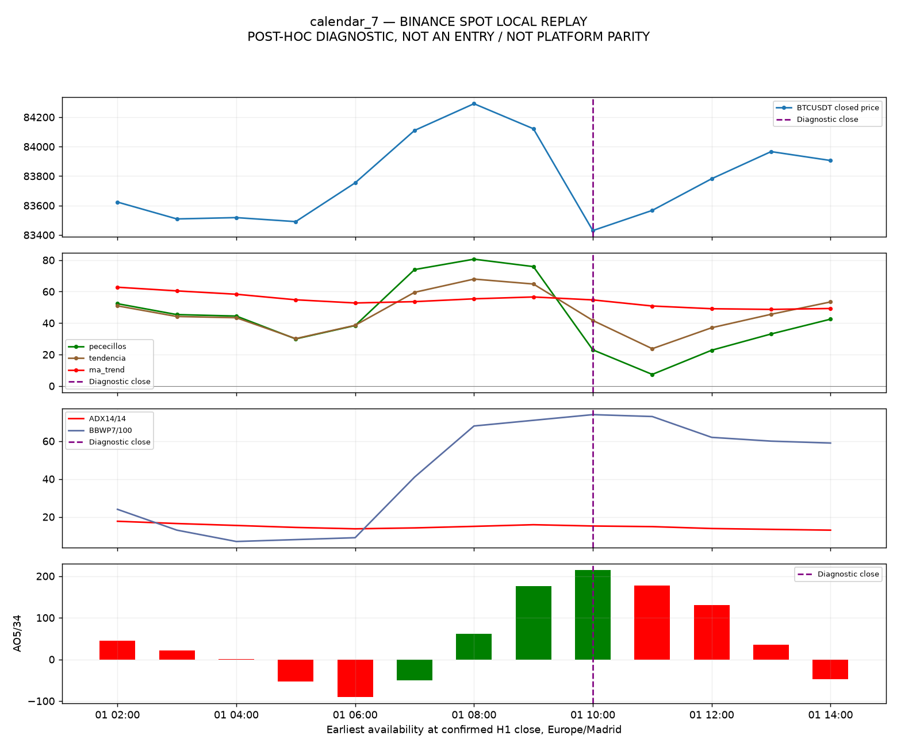

# Evidencia visual parcial, dos casos y eventos próximos

**INCONCLUSO. Diagnóstico post-hoc, no estrategia rentable ni señal operativa.**

PR #46 y PR #47 permanecen congeladas. Este trabajo añade únicamente este
subdirectorio en otra rama; reutiliza sus indicadores sin cambiarlos. No hay
backtest de operaciones, órdenes, merge, deploy ni acceso a cuentas.

## 1. Coincidencia externa visual comunicada por el propietario

Para BTCUSDT Binance **Spot**, H1, apertura **15/11/2026 02:00 Madrid =01:00 UTC**,
el propietario comunica que TradingOne muestra aproximadamente **−40,40** en el
área amarilla/oliva. El replay conserva:

| Serie | Python | Redondeo a dos decimales |
|---|---:|---:|
| pececillos | −40.39928839347632 | −40.40 |
| tendencia | −15.064153051502862 | −15.06 |
| tiburones | −16.931725237090735 | −16.93 |
| ma_trend | −4.069550666696239 | −4.07 |

Error absoluto frente al número mostrado: **0.00071160652368**, menor que medio
quantum de dos decimales, 0.005. Entre estas cuatro series por defecto solo
pececillos reproduce ese redondeo. Es evidencia externa visual **comunicada por
el propietario**, que apoya la identificación de ese punto. No hemos recibido
ni inspeccionado en esta tarea la captura original, no hay exportación numérica
nueva y no se conoce si la captura se tomó con esa vela aún abierta.

El valor final de esa vela solo está disponible desde **03:00 Madrid /02:00 UTC**.
No se puede atribuir ese valor cerrado a las 02:00 Madrid ni afirmar que se emitió
en directo a las 03:00. `visual_evidence.json` conserva origen y límites;
`artifacts/visual_point_comparison.json` registra el contraste reproducido.

**Estado: PARTIAL VISUAL SUPPORT, NOT COMPLETE CERTIFIED PARITY.**

## 2. Etiquetas y orden de plot del original

En la fuente original, conservada con su SHA256 de PR #46:

| Línea original | Variable | Título/tipo |
|---:|---|---|
| 306 | pececillos | Verde, área |
| 307 | tendencia | Marron, área |
| 308 | tiburones | Azul, área |
| 310 | tendencia | Lmarron, contorno |
| 311 | pececillos | Lineav, contorno |
| 312 | tiburones | Lazul, contorno |
| 313 | ma_trend | Media, línea roja |

Los colores por defecto de las tres áreas tienen transparencia55. El marrón es
`#FFCC99`, el verde `#05FF68`; se pueden superponer y cambiar en ajustes. La roja
es EMA15 de **tendencia**, no una media de pececillos. El original no configura
`explicit_plot_zorder`.

La documentación de [visuales de Pine](https://www.tradingview.com/pine-script-docs/visuals/overview/)
explica el orden dentro de cada grupo y cómo los estilos/valores pueden modificarse
en la interfaz. El orden y las etiquetas respaldan qué variable se dibuja, pero
no permiten identificar una serie solo por una mezcla visual de colores ni
certificar el renderer/configuración de TradingOne. La evidencia numérica puntual
es más discriminante que llamar «amarillo» a una región superpuesta.

## 3. Tabla 00:00–08:00 Madrid, Spot

Se muestran **aperturas** 00–08 y su cierre/disponibilidad mínima. El CSV conserva
además la vela anterior que cierra a las00:00 para cubrir ambos sentidos del rango.
Todos los valores siguientes son finales de velas cerradas; el último renglón
solo se conoce a las09:00. Valores redondeados aquí, precisión completa en CSV.

| Abre Madrid | Disponible al cierre | Pececillos | Tendencia | Roja | Tiburones | ADX | AO | BBWP |
|---|---|---:|---:|---:|---:|---:|---:|---:|
| 00:00 | 01:00 | −35.163 | −11.692 | −1.799 | 46.465 | 56.941 | −2512.231 | 96 |
| 01:00 | 02:00 | −27.473 | −7.400 | −2.499 | −19.351 | 57.017 | −2681.548 | 96 |
| 02:00 | 03:00 | −40.399 | −15.064 | −4.070 | −16.932 | 57.847 | −3000.521 | 97 |
| 03:00 | 04:00 | −12.966 | 8.617 | −2.484 | 175.973 | 55.720 | −2990.875 | 91 |
| 04:00 | 05:00 | 14.821 | 33.211 | 1.978 | 147.770 | 53.096 | −2626.664 | 92 |
| 05:00 | 06:00 | 19.781 | 35.512 | 6.170 | 138.373 | 50.731 | −2279.139 | 94 |
| 06:00 | 07:00 | 22.967 | 36.486 | 9.959 | 85.977 | 48.730 | −2004.372 | 92 |
| 07:00 | 08:00 | 21.651 | 33.777 | 12.936 | 75.230 | 47.126 | −1535.275 | 93 |
| 08:00 | 09:00 | 13.836 | 28.295 | 14.856 | 65.827 | 45.991 | −1335.395 | 86 |

Eventos conocidos al cerrar:

* **03:00 Madrid:** pececillos vuelve a empeorar su pendiente, sin cruce de roja.
* **04:00:** primer giro de recuperación de AO negativo; giro ADX desde máximo;
  pececillos gira al alza pero sigue bajo roja. Tendencia y tiburones sí cruzan.
* **05:00:** pececillos cruza roja y cero; segunda pendiente AO positiva. El ADX
  no gira desde un mínimo: continúa perdiendo fuerza desde el máximo anterior.
* **08:00:** pececillos cambia a pendiente negativa, todavía sobre roja; AO sigue
  verde. Otro ejemplo de que giro, cruce y cambio de color no son intercambiables.
* **09:00:** cruce bajista real de pececillos con la roja, mientras AO continúa
  recuperándose bajo cero. No implica automáticamente una tesis SHORT.

No hay giro ADX desde mínimo dentro de este tramo. Los CSV conservan todos los
flags, pendientes, DMI y antigüedades; el replay USD-M se guarda aparte, sin
sustituir la venue Spot ya indicada para el punto externo.

## 4. Segundo caso: agotamiento comunicado alrededor de las14:00

Es un caso **separado**. El propietario comunica pendiente de pececillos negativa,
AO rojo, ADX28–29, BBWP aproximadamente88→67 y una caída posterior cercana a1000.
El replay de velas Spot cerradas presenta esta secuencia distinta:

| Abre Madrid | Disponible | Pececillos | Roja | AO | Pendiente AO | ADX | BBWP |
|---|---|---:|---:|---:|---:|---:|---:|
| 12:00 | 13:00 | 64.674 | 32.055 | −610.991 | +287.348 | 35.442 | 75 |
| 13:00 | 14:00 | 70.004 | 36.841 | −301.052 | +309.939 | 33.180 | 75 |
| 14:00 | 15:00 | 73.480 | 41.458 | −51.607 | +249.445 | 30.850 | 69 |
| 15:00 | 16:00 | 59.344 | 44.485 | −122.591 | −70.984 | 29.723 | 40 |

**Al cierre de las16:00** se confirma giro de pendiente de pececillos y AO rojo.
Pececillos **59.34377957025818 >44.484598073672046**: no cruza bajista la roja.
El cruce bajista anterior fue a las09:00, y hubo recuperación posterior; no se
reutiliza aquel cruce como si acabara de producirse a las16:00.

El ADX ya descendía desde las04:00: llegar a29.72 no constituye un nuevo giro.
AO sigue bajo cero, no es el deterioro de AO **positivo** que exige la parte DOWN
del borrador. La combinación cerrada de las14:00 solicitada no se reproduce:
allí AO seguía verde, pececillos subía y ADX era33.18. BBWP40 al cierre16 tampoco
coincide con67. No se desplazan series/zonas horarias ni cambian fórmulas para
encajar la observación. Apertura frente a cierre, valores intrabar, configuración
u hora de captura siguen pendientes de contraste externo; no elegimos una causa.

Matemáticamente este caso sería una **recuperación fallida del AO negativo**,
distinta del deterioro de AO positivo. Son hipótesis diferentes. La primera se
registra aquí como observación del propietario; no se añade al detector para
aceptar retrospectivamente esta caída.

### La caída ya ocurrida no es beneficio anticipado

El máximo65800.75 pertenece a la vela14:00–15:00 Madrid. En la siguiente,
15:00–16:00, el mínimo es64456.01 y el cierre64766.08: diferencia máximo anterior
→cierre de **1034.67 USDT de precio**, y máximo anterior→mínimo de1344.74.

Esa caída ya está incorporada en la vela que permite conocer el giro a las16:00.
No se cuenta como movimiento posterior previsto por una confirmación de las16:00,
ni como PnL ejecutable. El dataset nuevo termina justamente en ese cierre;
seguimiento posterior a esa confirmación **CENSORED / PENDING**, no inventado.

## 5. Contexto superior disponible entonces

En las14:00,15:00 y16:00 Madrid se utiliza la misma última4H08:00–12:00 UTC.
La4H12:00–16:00 UTC todavía no está cerrada. El día15 y la semana9–16noviembre
tampoco se incorporan como velas superiores completas.

| Marco | Último cierre UTC disponible | AO | Pendiente AO | +DI | −DI | Concordancia descriptiva |
|---|---|---:|---:|---:|---:|---|
| 4H | 15nov12:00 | −6048.091 | +55.058 | 7.850 | 35.377 | DOWN; AO negativo recuperándose |
| 1D | 15nov00:00 | −7317.250 | −1240.103 | 8.454 | 41.768 | DOWN |
| 1W | 9nov00:00 | +7956.981 | −1727.850 | 18.141 | 19.050 | TRANSITION; AO positivo perdiendo impulso |

Esto apoya describir el rebote H1 dentro de un contexto4H/diario bajista. **No es
una alineación bajista uniforme de los tres marcos.** La concordancia AO/DMI se
usa solo para describir contexto, sin modificar el Direction Engine ni crear un
filtro de entrada. El semanal dispone de57 semanas: AO34 tiene warmup suficiente,
pero no SMA200 ni BBWP semanal completo. Su DMI/ADX depende del prefijo disponible,
y no se declara paridad de inicialización con una plataforma de historial mayor.

## 6. Detector propuesto y congelado para diagnóstico

`proposal.json`, commit previo `dbaf7fb`, hash
`f6ff11a8d0db416719828009a1c13c62b2805c7953dca2e4dcef239102c7fc38`.
Se conserva sin cambios después de medir los ejemplos adicionales.

Ventana única **[t−2,t]**, tres instantes de cierre, separación máxima2horas.
La propuesta combina cruce de área/roja, inicio de dos pendientes AO favorables
en el signo correctivo y un giro ADX, separando máximo/deceleración de mínimo/
recuperación de fuerza. No se mezclan ambos giros ADX como si significaran lo mismo.

La [especificación completa](README.md) define consumo de eventos, expiración
de todo el bundle e invalidación por AO, alineación de área, reversión ADX o datos.
No hay resurrección de eventos ni múltiples confirmaciones por un estado AO
persistente. Se fecha al último cierre necesario, no al máximo/mínimo anterior.

En la madrugada detecta proximidad UP a las05:00, manteniendo el giro ADX de04:00.
En el agotamiento de16:00 **no confirma DOWN**: no hay cruce nuevo de pececillos,
AO no está sobre cero y no hay nuevo giro ADX. Eso es una limitación de esta
hipótesis, no un motivo para cambiarla y capturar retrospectivamente la caída.

Las etiquetas no son entradas, ni órdenes, ni un journal forward real. El registro
lleva `RETROSPECTIVE_DIAGNOSTIC_REPLAY_NOT_FORWARD`. Entrada/SL/TP/costes/funding
siguen sin definir para una futura estrategia, que requiere otro protocolo.

## 7. Más ejemplos: calendario completo, no solo rebotes

El protocolo previo fija todas las velas desde1oct00UTC hasta15nov00UTC exclusivo,
45días anteriores a los dos casos principales. Se conservan **todos los cruces
pececillos/roja:122,61 alcistas y61 bajistas**. Para ilustrar falsas coincidencias
se describe únicamente el cambio de cierre cuatro horas después, no una entrada,
salida ni rentabilidad. Resultado:58 cierres en el sentido del cruce y64 en contra;
por lado,29/61 en el sentido y32/61 en contra. No hay casos censurados en ese tramo.

Los 122 eventos NO son122 operaciones ni122 observaciones independientes: hay
solapamientos de las ventanas4H. No se calcula win rate de trading, expectativa
neta, significación ni una ventaja inferida de estos conteos. Los costes y funding
no se aplican porque no existe una operación simulada en este diagnóstico.

Los ejemplos ilustrados son los dos primeros cronológicos de cada lado y de cada
resultado descriptivo. La selección está definida antes de medirla y no se utiliza
para estimar rendimiento; el CSV completo evita ocultar los restantes casos.

| Disponible UTC | Cruce | Cambio de cierre a4H, precio | Descripción |
|---|---|---:|---|
| 1oct05:00 | UP | −543.04 | Cruce alcista sin avance neto al cuarto cierre |
| 1oct15:00 | UP | +751.37 | Avance neto alcista |
| 5oct23:00 | UP | −390.08 | Otro cruce alcista desfavorable |
| 1oct08:00 | DOWN | +475.83 | Cruce bajista seguido de cierre superior |
| 2oct15:00 | DOWN | −1424.92 | Descenso neto |
| 3oct22:00 | DOWN | +87.44 | Otro cruce bajista desfavorable |

La misma propuesta fija registra40 proximidades primarias en ese calendario,
32 en contexto ADXdesde-máximo y8 desde-mínimo. **No se ha evaluado su PnL ni
seleccionado el contexto con mejores outcomes.**

### Hipótesis del contexto bajista superior, solo descriptiva

| Cruce | Contexto4H y1D | n | Cierre4H en sentido del cruce | En contra |
|---|---|---:|---:|---:|
| UP | Ambos DOWN | 30 | 14 | 16 |
| UP | Otros contextos | 31 | 15 | 16 |
| DOWN | Ambos DOWN | 29 | 13 | 16 |
| DOWN | Otros contextos | 32 | 16 | 16 |

`descriptive_context_groups.json` conserva también los19 grupos completos,
incluido el semanal. No se escoge un grupo/umbral ganador ni se crea un filtro
con el caso de hoy. El rango es pequeño, ya visto, con estados compartidos y
eventos dependientes. **No permite confirmar que el agotamiento H1 sea más
predictivo en contexto bajista superior.** Esta pregunta necesita una
especificación y evaluación distinta, conservando también todos los no-aciertos.

## 8. Qué está demostrado y qué falta

* Demostrado localmente: semántica matemática, tiempos de cierre, diferencia entre
  giro/cruce/cero, conservación del punto −40.399288 y agregación causal superior.
* Apoyo externo parcial: un número redondeado comunicado por el propietario.
  No certifica otras velas, ADX, BBWP, parámetros, inicialización o emisión live.
* Caso de tarde: nuestro cierre16 respalda giro de pendiente y color AO, sin
  cruce; no reproduce exactamente hora14 ni BBWP67. Falta evidencia externa
  fechada para resolver esas diferencias sin inventar explicaciones.
* Propuesta congelada para revisión y pruebas de causalidad; no es una nueva
  estrategia aprobada. No se retocó para aceptar el agotamiento que no cumple.
* Más ejemplos reales y desfavorables están incluidos. **NO VIRGIN HOLDOUT.**
* Conclusión global: **INCONCLUSO — NO AUTORIZAR OPERATIVA NI INTEGRACIÓN**.

Validaciones y hashes: `validation.json`, `evidence_checksums.json`. Las dos GET
nuevas son públicas y sin credenciales; no se accede a Railway o Bitunix. Guardian,
V8, ML RSI, operabilidad, market-data, Telegram, riesgo, ejecución y protocolos
previos permanecen intactos. SHADOW ONLY. TRADE AUTHORITY: NONE.
