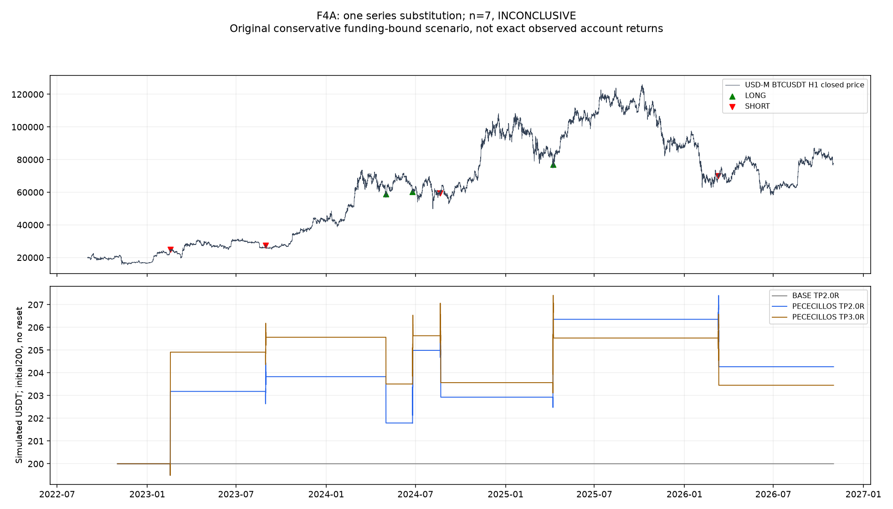
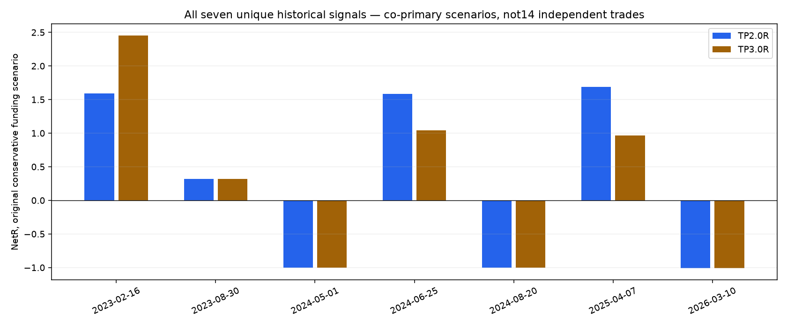

# Fase4A — ¿cuántas señales produce la regla estricta con pececillos?

**Respuesta:7 señales,3LONG y4SHORT, en cuatro años. Las7 se ejecutan en el
simulador original, por separado con TP2R y TP3R. BASE reproduce0 señales.**

**Conclusión: INCONCLUSO.** La sustitución resuelve una discrepancia de identidad
y permite reproducir señales; no demuestra rentabilidad. No se relaja ninguna
condición ni se selecciona un target, lado, ventana o filtro ganador.

## Alcance y congelamiento

PR #46/#47/#48 y todos sus archivos anteriores permanecen intactos. Solo se añade
este subdirectorio, en una nueva rama desde el HEAD384032d de PR #48.

El protocolo se congeló en `e626d46d278f115947a5ae69a2e8b6999401a272`, SHA256
`59d72126409f2882bc0dbdda1ef5719ad2530be1132e7d7eb10007b2dbcbe99d`, antes del
recuento histórico. `variants.py` y el evaluador se registraron en `55b904a`
antes de ejecutarse. La elección de pececillos está informada por la evidencia
visual y la revisión retrospectiva: **NO VIRGIN HOLDOUT**.

La única sustitución es la serie `kon_trend` recibida por la función original
`signals`: se le pasa `minnows/pececillos`. La roja continúa siendo EMA15 de
**tendencia**. El signo previo se comprueba sobre la serie cruzada, pececillos.
No se recalculan indicadores ni se cambian ADX/AO/BBWP/ATR, motor o financiación.
No se llama al detector de proximidad de PR #48 ni se estudia ADXdesde-mínimos.

## Datos idénticos a PR #46

BTCUSDT **BINANCE_USDM_PERPETUAL**, no Bitunix ni Spot. Warmup1septiembre2022;
evaluación1noviembre2022–31octubre2026 inclusive. **36.528 velas H1 cerradas,
1.464 de warmup y35.064 evaluadas**, sin velas rellenadas ni nueva descarga.

NPZ original SHA256:
`5b2544c9bf353cedb77a07781ffe9e6202b12513c0c10f3d25bca67756a4825a`.
El loader original comprueba ese archivo y los153 inputs raw referenciados en
su manifiesto:148 archivos públicos y5 respuestas públicas de financiación.
Se mantienen las48horas de markprice recuperadas originalmente y las limitaciones
de marcas de funding ausentes; no se vuelven a descargar ni corregir datos.

## Embudo acumulado, misma hora y mismas condiciones

| Variante/lado | Cruce+signo previo | +ADX original | +AO dos pendientes | +BBWP>85 |
|---|---:|---:|---:|---:|
| BASE LONG |61|0|0|0|
| BASE SHORT |2363|73|21|0|
| PECECILLOS LONG |142|13|9|3|
| PECECILLOS SHORT |2223|172|71|4|

No se ha introducido una ventana entre eventos. El ADX sigue siendo
`ADX[t-1]<ADX[t-2]` y `ADX[t-2]>40`, no un giro actual ni un mínimo ADX.
AO mantiene signo y dos pendientes estrictas. BBWP conserva la fórmula literal
SMA7/prior100 de PR #46 y la desigualdad estricta>85.

Las siete señales no se solapan: las siete se simulan en COMBINED bajo ambos
targets; no hay rechazos por solapamiento ni purga en FULL. Cada target constituye
un escenario distinto. **No son14 oportunidades independientes**, ni se suman
LONG_ONLY/SHORT_ONLY o las repeticiones de DEVELOPMENT/TEST.

## Resultados descriptivos netos, con sus límites

Capital inicial200USDT; riesgo planificado1% incluyendo costes del stop; nominal
limitado al capital, sin multiplicador de apalancamiento. Entrada siguiente apertura
con0.05% adverso; comisión0.1% por lado. Son hipótesis de PR #46, no tarifas de una
cuenta verificadas. Stop1.5ATR de señal, targets brutos2R/3R y salida temporal tras
24velas completas. Aperturas/gaps primero; stop primero si ambos niveles se tocan
sin orden intrabar conocido. No hay ajustes del motor para esta comparación.

**Los siguientes resultados COMBINED son escenarios de financiación, no un punto
neto exacto certificado:** una operación de agosto2023 usa tres marcas de funding
ausentes. Se conservan tasas reales y cotas high/low de markprice originales.
`exact_net_usdt` permanece null para el total, aunque la amplitud monetaria de
esta cota concreta sea pequeña. No se sustituyen las marcas ausentes por0.

| Variante/target | n | Favorables/perdedoras | Neto conservador USDT | Cota alternativa USDT | Esperanza neta R conservadora | PF conservador | DD cierre | DD adverso, cota |
|---|---:|---|---:|---:|---:|---:|---:|---:|
| BASE2R |0|N/A|0 por inactividad|0|N/A|N/A|0 por inactividad|0|
| BASE3R |0|N/A|0 por inactividad|0|N/A|N/A|0 por inactividad|0|
| PECECILLOS2R |7|4/3|+4.267469|+4.267539|+0.309437|1.690203|1.9090%|2.3850%|
| PECECILLOS3R |7|4/3|+3.453177|+3.453247|+0.252470|1.557107|1.9090%|2.3850%|

La cota adversa de drawdown utiliza la vela completa, incluida la de salida:
no es una trayectoria intrabar observada. Un drawdown pequeño con7operaciones
y exposición de solo100/126horas en35.064horas no demuestra bajo riesgo.

Descomposición conservadora COMBINED:

| Target | Bruto sin fricción | Comisiones | Slippage | Funding neto pagado | Neto escenario |
|---|---:|---:|---:|---:|---:|
|2R|6.614760|1.545277|0.772640|0.029374|4.267469|
|3R|5.825717|1.547253|0.773628|0.051659|3.453177|

Hay0 salidas ambiguas stop/target en estos trades, pero2 pérdidas que superan
ligeramente1R por funding posterior, como ya permite/contabiliza el motor original.
El riesgo planificado no garantiza una pérdida máxima exacta ante costes futuros
o gaps. No se cambia esa limitación ni se presenta como protección en Bitunix.

### LONG y SHORT, cuentas contrafactuales independientes

| Lado | n | Esperanza2R | PF2R | Esperanza3R | PF3R |
|---|---:|---:|---:|---:|---:|
|LONG_ONLY|3|+0.756849|3.264288|+0.336029|1.997972|
|SHORT_ONLY|4|−0.026122|0.937524|+0.189801|1.350071|

LONG no utiliza marcas ausentes en esta muestra. SHORT sí; sus cifras mostradas
son del escenario conservador. Estas cuentas no se combinan ni autorizan elegir
LONG o3R por verse mejor con3/4observaciones.

### Resultados anuales sin reiniciar la cuenta

| Año, cobertura | LONG/SHORT | n | Neto2R USDT | Neto3R USDT | DD anual cierre2R | DD anual cierre3R |
|---|---|---:|---:|---:|---:|---:|
|2022,nov–dic|0/0|0|0|0|0|0|
|2023|0/2|2|+3.831475|+5.564380|0.4722%|0.4722%|
|2024|2/1|3|−0.902132|−1.996725|1.6889%|1.6889%|
|2025|1/0|1|+3.424394|+1.963474|0.2239%|0.9062%|
|2026,ene–oct|0/1|1|−2.086268|−2.077952|1.5123%|1.5123%|

No hay consistencia demostrada entre épocas; los años positivos tienen1–2trades.
Los importes conservan el capital resultante cronológico. Las métricas de cada
cohorte y los cambios de equity calendario se distinguen en `annual.csv`.

## Siete oportunidades únicas: todas, incluidas pérdidas

R netas del escenario conservador; la fecha es la **disponibilidad al cierre UTC**,
que coincide con la siguiente apertura de referencia del modelo, no con un fill live.

| Disponible UTC | Lado | R neta2R | R neta3R |
|---|---|---:|---:|
|16feb2023 18:00|SHORT|+1.591076|+2.454768|
|30ago2023 03:00|SHORT|+0.319577|+0.319577|
|1may2024 19:00|LONG|−1.000000|−1.000000|
|25jun2024 01:00|LONG|+1.583066|+1.043557|
|20ago2024 15:00|SHORT|−1.004127|−1.004127|
|7abr2025 11:00|LONG|+1.687481|+0.964531|
|10mar2026 19:00|SHORT|−1.011015|−1.011015|

2R/3R son distancias brutas sobre ATR; comisiones y slippage explican por qué
los beneficios netos no son2R/3R. Los timeouts pueden terminar positivos sin
tocar el target. Ninguna operación ni rechazo se elimina mirando el resultado.

## Incertidumbre, controles y particiones originales

Se reutiliza el bootstrap original:2000réplicas de bloques calendario7días,
días sin eventos incluidos y CI97.5% para los dos targets co-primarios.

| Target | Esperanza FULL | CI97.5% R | Media de controles FULL | CI97.5% de diferencia frente controles |
|---|---:|---|---:|---|
|2R|+0.309437|[−1.003867,+1.588406]|−0.129411|[−0.865722,+1.698374]|
|3R|+0.252470|[−1.003867,+1.513961]|−0.087867|[−0.913840,+1.646615]|

Los intervalos son amplios y cruzan0. Los200controles de cada target/libro/ventana
usan exactamente el procedimiento de PR #46: mismo mes, lado y régimen causal
4H cerrado respecto a SMA200; misma simulación/costes/funding. En FULL/COMBINED
cada control termina ejecutando7trades, como la estrategia, pero otros muestreos
pueden diferir por solapamientos. No es un p-value formal ni demuestra edge.
185/200 y191/200 controles FULL, respectivamente, usan alguna marca de funding
ausente; también son escenarios, no registros netos observados exactos.

Se conservan la división70/30, embargo24horas y purga de final. TEST contiene
**solo1 SHORT y0 LONG**, perdido con ambos targets:−1.011015R,−2.022031USDT en la
cuenta TEST que empieza200USDT. La pérdida FULL es algo distinta porque su capital
ya había evolucionado. TEST no es un holdout virgen ni una campaña forward.

Con n=1, el bootstrap condicional devuelve un intervalo degenerado igual al
único R observado. **Eso no significa incertidumbre cero** ni permite declarar
NO EDGE con confianza. Los mínimos originales son60trades TEST combinados o30
por lado; ninguno se cumple. No se promueve una variante con esa evidencia.

Las cuatro WF originales contienen1,2,0,1trades. Hay un fold negativo y otro
vacío; no ofrecen una validación independiente robusta. No se entrena nada.

Sensibilidad a casos extraordinarios, sin cambiar reglas:

| Target | Media R sin mejor1 | Media R sin mejores3 |
|---|---:|---:|
|2R|+0.079763|−0.673891|
|3R|−0.114580|−0.673891|

La aparente ventaja media depende de muy pocos eventos. No se exploran nuevos
umbrales ni se selecciona2R por salir mejor en este histórico.

## Episodio15nov2026: señal reproducida, fuera del estudio principal

La vela abre04:00Madrid /03:00UTC y cierra05:00Madrid /04:00UTC.
BASE no produce señal; PECECILLOS produce LONG en **Spot y USD-M por separado**.

| Condición en Spot | Valores cerrados | Resultado |
|---|---|---|
|Cruce pececillos/roja|previo−12.965537≤−2.483791; actual14.821006>1.978063|Sí|
|Signo previo pececillos|−12.965537<0|Sí|
|ADX original|55.719785<57.846531 y57.846531>40|Sí|
|AO original|−2626.663765<0 y−2626.663765>−2990.874529>−3000.521206|Sí|
|BBWP original|92>85|Sí|

Primera apertura del **modelo**:05:00Madrid /04:00UTC en ambos mercados.

| Venue | Referencia siguiente open | Entrada modelada con0.05% adverso |
|---|---:|---:|
|Binance Spot|64826.00|64858.4130|
|Binance USD-M|64798.40|64830.7992|

Confirmación y siguiente apertura comparten frontera temporal. Un sistema real
recibe datos y actúa después: no se garantiza ejecutar el primer print ni se
afirma haber observado un fill. Se mantiene exactamente la convención de PR #46
para la comparación, sin optimizar latencia retrospectivamente.

El episodio no se añade a las7señales, no entra en TEST y no se puntúa su PnL.
No se usa para escoger target. Spot no se convierte en ejecución de futuros.
La coincidencia visual puntual apoya la identidad de pececillos; la paridad
externa completa de todos los indicadores sigue sin estar certificada.

## Decisión y paquete de auditoría

**INCONCLUSO.** Cambiar exclusivamente a pececillos convierte0señales en7, y
reproduce el caso de noviembre. Es suficiente para comprobar ese hallazgo,
pero insuficiente para sostener una ventaja neta robusta. No se relajan filtros
para aumentar muestra ni se inician nuevas variantes/ventanas.

`audit_bundle/IGOD_F4A_CLAUDE.zip` contiene los ocho archivos solicitados de PR #48
desde su commit original, más esta comparación, informe, todos los resultados,
pruebas y datos públicos originales verificables. Su manifiesto registra hashes
y procedencia. No se ha enviado el paquete a Claude ni se afirma una revisión
independiente ya realizada. Consulte [README](README.md) para reproducirlo.

Los resultados de pruebas y guards están en `validation.json`; hashes en
`evidence_checksums.json` y `audit_bundle_sha256.json`. No se modifican Guardian,
V8, ML RSI, operabilidad, protocolos/journals semanales, Telegram ni infraestructura.
No Railway, Bitunix, órdenes, merge o deploy. SHADOW ONLY. TRADE AUTHORITY: NONE.
