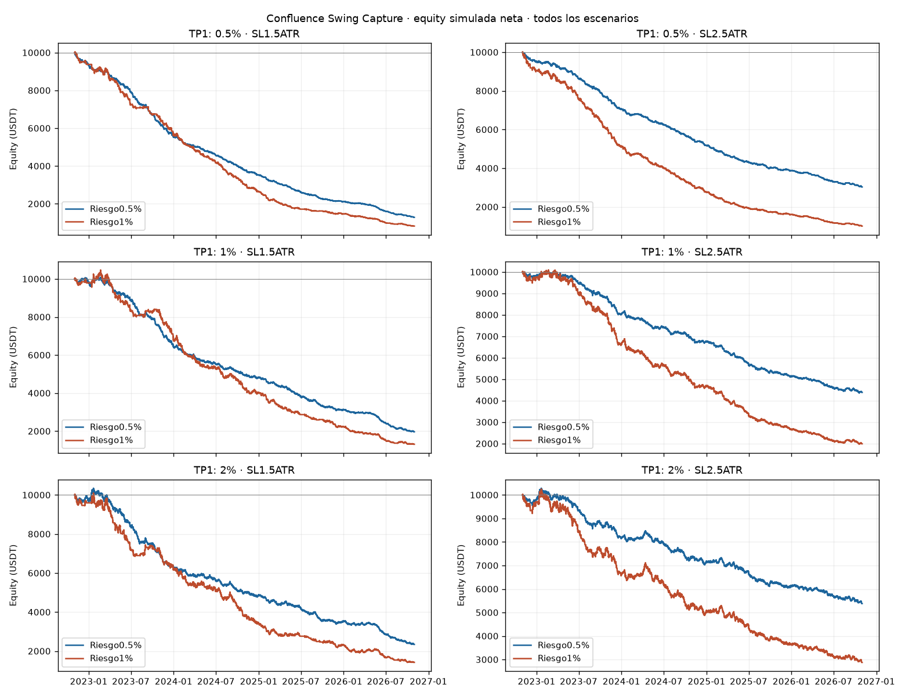
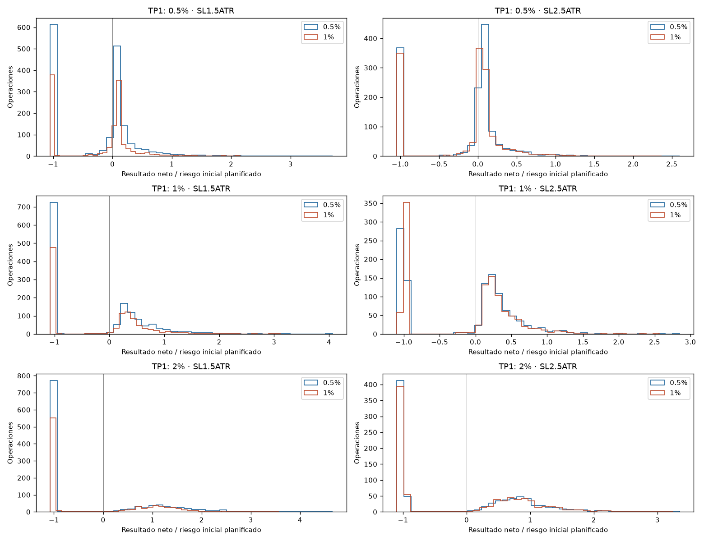
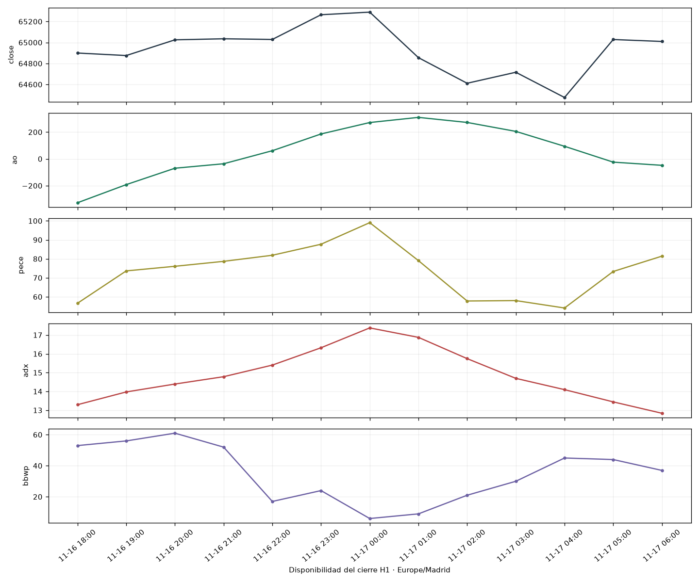
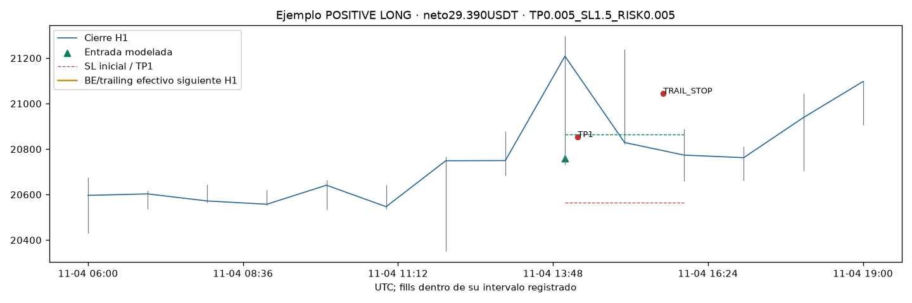
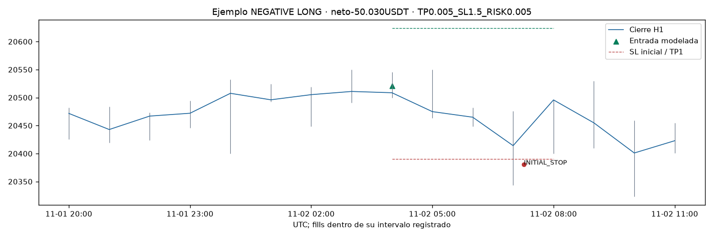
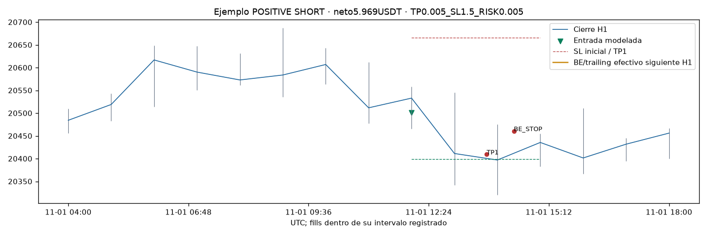
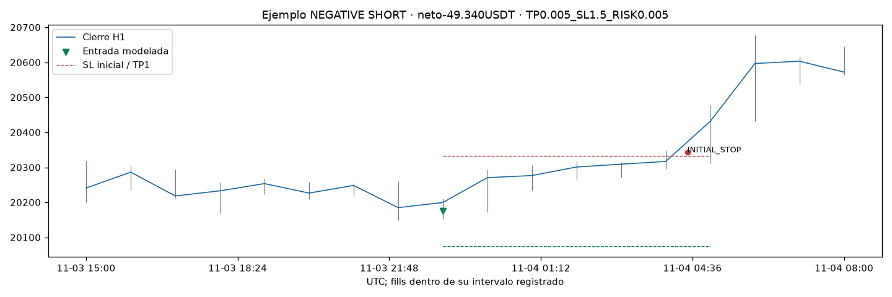

# I-GOD — Confluence Swing Capture V0

**NO EDGE EN LOS ESCENARIOS ESTUDIADOS. SHADOW ONLY. TRADE AUTHORITY: NONE.**

Se han evaluado exactamente12 configuraciones, sin elegir una ganadora ni cambiar parámetros después de ver resultados. 0/12 tienen esperanza neta observada positiva. Esto no demuestra ausencia universal de efecto ni valida una variante: estudia esta formalización causal y esta gestión concreta.

## Qué se congeló y qué se está probando

Plan previo a resultados: commit `3be6d3038eb4eb944ed551674206164f053c2763`, SHA256 `c68e09966e6501b1c95338ac4d44607bf26289487a5f4e8a20875e0e8c187a97`. AO5/34, ADX/DMI14, pececillos del proxy público original, roja EMA15(tendencia), BBWP7/100 y ATR14 no se modificaron. No certificamos paridad con indicadores privados Bitman/TradingOne.

Cuatro giros nuevos en una ventana máxima2h. AO y pececillos1+1 deben coincidir en lado y seguir con esa pendiente; ADX y BBWP pueden girar a cualquier lado y se anotan como fase. No se exigen cruces de cero, Q75,2+2 ni contexto superior. Los tokens expiran/se invalidan y se consumen una vez; no hay cooldown extra. Se conservan todos los intentos fallidos y señales bloqueadas.

TP1:0,5/1/2% desde el fill; SL:1,5/2,5ATR de la señal; parcial50%; runner con BE neto y trailing1,5ATR. La referencia entra en la apertura H1 posterior con slippage: **no es un fill real observado**. Un solo trade; no se invierte automáticamente por señal contraria. No hay nuevo TP2 ni salida temporal arbitraria; cierre forzoso al final del archivo identificado aparte.

BE/trailing se actualizan al cierre H1 y son efectivos en la hora siguiente. No protegen retrospectivamente dentro de la vela TP1. Esta granularidad conservadora puede diferir de un gestor que reaccione inmediatamente intraminuto; no se cambió tras los resultados. Stops nunca se amplían. El BE protege la porción restante sin gastar el beneficio TP1; gaps/funding posterior pueden dejar pérdidas aunque el motivo de salida sea BE.

## Datos y ejecución

BTCUSDT **Binance USD-M perpetual**, no Spot ni Bitunix. Histórico2022-11-01 a2026-10-31; calentamiento desde2022-09-01. NPZ H1 auditado:`5b2544c9bf353cedb77a07781ffe9e6202b12513c0c10f3d25bca67756a4825a`. 35,064 cierres de estudio; 2,050 señales, 1045LONG y1005SHORT. Todo el histórico ya estaba examinado: **NO VIRGIN HOLDOUT**. No hay observación prospectiva.

2,103,840 velas1m oficiales con checksum. 35,056 horas reproducen exactamente el OHLC H1 y su volumen dentro de tolerancia numérica fijada. La fuente minuto es la misma venue. En una vela que toca TP1 y SL se usa el orden1m; si ambos aparecen en el mismo minuto, primero el resultado adverso. Horas incompletas/incompatibles usan H1 adverso y quedan contadas. Las excursiones MFE/MAE usan rangos de las barras mantenidas, incluida la barra de salida: **son cotas de barra, no extremos intratick certificados antes del fill**.

Comisión conservadora0,1% por fill y slippage adverso0,05% por fill. Son supuestos, no tarifas personales Bitunix ni prueba de ejecución allí. Funding real USD-M con su timestamp completo:1.657 pagos tienen offsets1–29ms. No se redondean a la hora. Si un fill coincide con su intervalo, se conserva el rango de BTC que pudo estar abierto. Marks ausentes usan los límites H1 previamente auditados, no cero. Se contabiliza al cierre H1: los rangos aún abiertos no afectan a tamaño/stop intrahora. `funding.csv` conserva cada cargo y sus límites.

Capital inicial independiente10.000USDT por configuración; se utiliza el restante cronológico, sin reinicio ni aportaciones. Riesgo planificado0,5/1% hasta el stop **incluyendo comisiones y slippage**. El funding futuro/gaps puede superar ese presupuesto. Si el tamaño requerido excede capital totalmente colateralizado1x, se rechaza `LEVERAGE_REQUIRED`; no se reduce el tamaño y se dice que cumple riesgo constante. No se usa liquidación como stop ni se simula que abrir SHORT Spot sin préstamo sea ejecutable. No se certifican mínimos/tiers ni liquidación histórica de Bitunix.

## Resultados completos — orden fijo predeclarado

Drawdown = máximo de equity marcado a cierres H1, incluidos PnL flotante/costes/funding. No equivale al peor drawdown intratick. Ganador = resultado neto positivo, no simplemente haber tocado TP1. Beneficio/pérdida media y esperanza en USDT varían con el equity cronológico; R se refiere exclusivamente al presupuesto inicial calculado al stop.

| Configuración | Trades | LONG | SHORT | Acierto % | Esperanza neta R | PF | Cuenta % | DD cierre % |
| --- | --- | --- | --- | --- | --- | --- | --- | --- |
| TP0,5% / SL1.5 / riesgo0,5% | 1608 | 809 | 799 | 55.29 | -0.254 | 0.353 | -87.17 | 87.19 |
| TP0,5% / SL1.5 / riesgo1% | 1158 | 565 | 593 | 59.67 | -0.214 | 0.377 | -91.76 | 91.82 |
| TP0,5% / SL2.5 / riesgo0,5% | 1339 | 671 | 668 | 64.53 | -0.178 | 0.366 | -69.71 | 69.73 |
| TP0,5% / SL2.5 / riesgo1% | 1295 | 650 | 645 | 64.94 | -0.176 | 0.356 | -89.93 | 89.94 |
| TP1% / SL1.5 / riesgo0,5% | 1400 | 709 | 691 | 47.43 | -0.230 | 0.579 | -80.34 | 80.57 |
| TP1% / SL1.5 / riesgo1% | 1038 | 511 | 527 | 52.70 | -0.192 | 0.618 | -86.88 | 87.47 |
| TP1% / SL2.5 / riesgo0,5% | 1099 | 560 | 539 | 60.24 | -0.149 | 0.619 | -56.13 | 56.53 |
| TP1% / SL2.5 / riesgo1% | 1075 | 549 | 526 | 60.74 | -0.147 | 0.622 | -80.08 | 80.48 |
| TP2% / SL1.5 / riesgo0,5% | 1140 | 580 | 560 | 31.93 | -0.251 | 0.636 | -76.57 | 77.36 |
| TP2% / SL1.5 / riesgo1% | 875 | 434 | 441 | 35.77 | -0.217 | 0.662 | -85.77 | 85.94 |
| TP2% / SL2.5 / riesgo0,5% | 834 | 433 | 401 | 44.60 | -0.146 | 0.734 | -46.19 | 47.70 |
| TP2% / SL2.5 / riesgo1% | 816 | 424 | 392 | 44.98 | -0.148 | 0.723 | -71.22 | 71.94 |

### Descomposición del mismo ledger de fills

El bruto sin fricciones conserva las cantidades y decisiones simuladas; no es una estrategia alternativa ejecutada sin costes. Funding negativo significa crédito. No se rebajan costes para buscar una configuración positiva.

| Configuración | PnL precio antes fricción USDT | Slippage USDT | Comisiones USDT | Funding conservador USDT | PnL neto USDT |
| --- | --- | --- | --- | --- | --- |
| TP0,5% / SL1.5 / riesgo0,5% | 561.10 | 3088.47 | 6176.94 | 12.84 | -8717.14 |
| TP0,5% / SL1.5 / riesgo1% | 707.84 | 3288.21 | 6576.42 | 19.66 | -9176.46 |
| TP0,5% / SL2.5 / riesgo0,5% | -328.31 | 2211.26 | 4422.52 | 8.52 | -6970.61 |
| TP0,5% / SL2.5 / riesgo1% | -846.77 | 2712.85 | 5425.70 | 7.22 | -8992.55 |
| TP1% / SL1.5 / riesgo0,5% | 1642.76 | 3220.62 | 6441.24 | 14.66 | -8033.77 |
| TP1% / SL1.5 / riesgo1% | 2346.57 | 3666.38 | 7332.76 | 35.92 | -8688.48 |
| TP1% / SL2.5 / riesgo0,5% | 715.41 | 2101.76 | 4203.52 | 23.54 | -5613.41 |
| TP1% / SL2.5 / riesgo1% | 971.57 | 2985.31 | 5970.62 | 23.37 | -8007.72 |
| TP2% / SL1.5 / riesgo0,5% | 225.93 | 2624.31 | 5248.62 | 9.66 | -7656.67 |
| TP2% / SL1.5 / riesgo1% | -19.01 | 2849.53 | 5699.06 | 9.04 | -8576.63 |
| TP2% / SL2.5 / riesgo0,5% | 503.58 | 1698.06 | 3396.12 | 28.34 | -4618.93 |
| TP2% / SL2.5 / riesgo1% | 228.95 | 2442.22 | 4884.43 | 24.61 | -7122.31 |

| Configuración | Ganancia media USDT | Pérdida media USDT | Esperanza USDT | Racha pérdidas | MFE media % cota | MAE media % cota | Peor trade R |
| --- | --- | --- | --- | --- | --- | --- | --- |
| TP0,5% / SL1.5 / riesgo0,5% | 5.35 | -18.74 | -5.42 | 8 | 0.894 | 0.665 | -1.051 |
| TP0,5% / SL1.5 / riesgo1% | 8.04 | -31.55 | -7.92 | 8 | 0.989 | 0.738 | -1.051 |
| TP0,5% / SL2.5 / riesgo0,5% | 4.67 | -23.16 | -5.21 | 5 | 1.016 | 0.894 | -1.044 |
| TP0,5% / SL2.5 / riesgo1% | 5.91 | -30.76 | -6.94 | 5 | 1.027 | 0.908 | -1.044 |
| TP1% / SL1.5 / riesgo0,5% | 16.67 | -25.95 | -5.74 | 14 | 1.191 | 0.776 | -1.080 |
| TP1% / SL1.5 / riesgo1% | 25.69 | -46.32 | -8.37 | 8 | 1.308 | 0.861 | -1.079 |
| TP1% / SL2.5 / riesgo0,5% | 13.77 | -33.70 | -5.11 | 8 | 1.412 | 1.091 | -1.098 |
| TP1% / SL2.5 / riesgo1% | 20.18 | -50.21 | -7.45 | 8 | 1.421 | 1.104 | -1.098 |
| TP2% / SL1.5 / riesgo0,5% | 36.76 | -27.11 | -6.72 | 25 | 1.459 | 0.919 | -1.079 |
| TP2% / SL1.5 / riesgo1% | 53.67 | -45.15 | -9.80 | 12 | 1.605 | 1.023 | -1.079 |
| TP2% / SL2.5 / riesgo0,5% | 34.22 | -37.55 | -5.54 | 9 | 1.889 | 1.368 | -1.098 |
| TP2% / SL2.5 / riesgo1% | 50.72 | -57.32 | -8.73 | 9 | 1.902 | 1.387 | -1.098 |

## Parciales y salidas

BE y trailing armados no garantizan beneficio; el resultado es el neto real del ledger simulado.

| Configuración | TP1 % | Salida BE | Salida trailing | SL inicial | Final archivo | Orden resuelto1m | Ambiguo1m adverso | H1 adverso sin1m | Rechazo capital1x | Posición ya abierta |
| --- | --- | --- | --- | --- | --- | --- | --- | --- | --- | --- |
| TP0,5% / SL1.5 / riesgo0,5% | 61.88 | 647 | 338 | 623 | 0 | 16 | 1 | 0 | 2 | 440 |
| TP0,5% / SL1.5 / riesgo1% | 67.18 | 538 | 233 | 387 | 0 | 11 | 0 | 0 | 616 | 276 |
| TP0,5% / SL2.5 / riesgo0,5% | 72.44 | 645 | 322 | 372 | 0 | 6 | 0 | 0 | 0 | 711 |
| TP0,5% / SL2.5 / riesgo1% | 72.97 | 636 | 306 | 353 | 0 | 6 | 0 | 0 | 84 | 671 |
| TP1% / SL1.5 / riesgo0,5% | 48.07 | 169 | 500 | 731 | 0 | 5 | 0 | 0 | 2 | 648 |
| TP1% / SL1.5 / riesgo1% | 53.66 | 168 | 384 | 486 | 0 | 6 | 0 | 0 | 541 | 471 |
| TP1% / SL2.5 / riesgo0,5% | 61.33 | 171 | 500 | 428 | 0 | 3 | 0 | 0 | 0 | 951 |
| TP1% / SL2.5 / riesgo1% | 61.86 | 171 | 491 | 413 | 0 | 3 | 0 | 0 | 64 | 911 |
| TP2% / SL1.5 / riesgo0,5% | 31.93 | 6 | 357 | 777 | 0 | 1 | 0 | 0 | 1 | 909 |
| TP2% / SL1.5 / riesgo1% | 35.77 | 6 | 306 | 563 | 0 | 1 | 0 | 0 | 466 | 709 |
| TP2% / SL2.5 / riesgo0,5% | 44.60 | 6 | 366 | 462 | 0 | 0 | 0 | 0 | 0 | 1216 |
| TP2% / SL2.5 / riesgo1% | 44.98 | 6 | 361 | 449 | 0 | 0 | 0 | 0 | 56 | 1178 |

## LONG y SHORT separados

| Configuración | Lado | N | Acierto % | Esperanza R | PF | Neto total USDT |
| --- | --- | --- | --- | --- | --- | --- |
| TP0,5% / SL1.5 / riesgo0,5% | SHORT | 799 | 53.82 | -0.269 | 0.323 | -4708.26 |
| TP0,5% / SL1.5 / riesgo0,5% | LONG | 809 | 56.74 | -0.240 | 0.385 | -4008.88 |
| TP0,5% / SL1.5 / riesgo1% | SHORT | 593 | 57.67 | -0.232 | 0.341 | -5251.58 |
| TP0,5% / SL1.5 / riesgo1% | LONG | 565 | 61.77 | -0.194 | 0.420 | -3924.89 |
| TP0,5% / SL2.5 / riesgo0,5% | SHORT | 668 | 62.28 | -0.197 | 0.326 | -3887.44 |
| TP0,5% / SL2.5 / riesgo0,5% | LONG | 671 | 66.77 | -0.158 | 0.411 | -3083.17 |
| TP0,5% / SL2.5 / riesgo1% | SHORT | 645 | 63.41 | -0.183 | 0.339 | -4693.52 |
| TP0,5% / SL2.5 / riesgo1% | LONG | 650 | 66.46 | -0.168 | 0.374 | -4299.03 |
| TP1% / SL1.5 / riesgo0,5% | SHORT | 691 | 46.74 | -0.244 | 0.534 | -4425.34 |
| TP1% / SL1.5 / riesgo0,5% | LONG | 709 | 48.10 | -0.217 | 0.624 | -3608.43 |
| TP1% / SL1.5 / riesgo1% | SHORT | 527 | 52.18 | -0.199 | 0.588 | -4732.62 |
| TP1% / SL1.5 / riesgo1% | LONG | 511 | 53.23 | -0.186 | 0.649 | -3955.86 |
| TP1% / SL2.5 / riesgo0,5% | SHORT | 539 | 59.74 | -0.161 | 0.585 | -2957.61 |
| TP1% / SL2.5 / riesgo0,5% | LONG | 560 | 60.71 | -0.137 | 0.651 | -2655.80 |
| TP1% / SL2.5 / riesgo1% | SHORT | 526 | 60.84 | -0.146 | 0.615 | -3860.05 |
| TP1% / SL2.5 / riesgo1% | LONG | 549 | 60.66 | -0.149 | 0.628 | -4147.68 |
| TP2% / SL1.5 / riesgo0,5% | SHORT | 560 | 31.79 | -0.262 | 0.590 | -4277.25 |
| TP2% / SL1.5 / riesgo0,5% | LONG | 580 | 32.07 | -0.241 | 0.682 | -3379.42 |
| TP2% / SL1.5 / riesgo1% | SHORT | 441 | 36.05 | -0.209 | 0.646 | -4554.01 |
| TP2% / SL1.5 / riesgo1% | LONG | 434 | 35.48 | -0.224 | 0.678 | -4022.62 |
| TP2% / SL2.5 / riesgo0,5% | SHORT | 401 | 44.89 | -0.159 | 0.692 | -2560.36 |
| TP2% / SL2.5 / riesgo0,5% | LONG | 433 | 44.34 | -0.134 | 0.772 | -2058.57 |
| TP2% / SL2.5 / riesgo1% | SHORT | 392 | 45.92 | -0.140 | 0.704 | -3655.46 |
| TP2% / SL2.5 / riesgo1% | LONG | 424 | 44.10 | -0.155 | 0.741 | -3466.85 |

## Referencias inclusivas por régimen — misma gestión

100 semillas fijas. Igual número de señales brutas por lado/mes/régimen4H/tercil causal de volatilidad; universo incluye eventos y vecinos. Muestreo sin reemplazo por celda, sin consultar retornos. Las colisiones opuestas se descartan. Cada calendario usa el mismo motor, capital, costes, funding, intrabar, parciales y restricciones. Ocupación/duración/capital pueden cambiar el N ejecutado: se publica, no se finge emparejamiento uno-a-uno de trades ejecutados.

Los percentiles5/50/95 son dispersión de100 calendarios de referencia en la misma historia; **no son IC95, p-valores ni100 historias independientes**. No se escoge una semilla por su resultado.

| Configuración | R observado | Referencia P5 | Referencia mediana | Referencia P95 | N real | N referencia mediana |
| --- | --- | --- | --- | --- | --- | --- |
| TP0,5% / SL1.5 / riesgo0,5% | -0.254 | -0.290 | -0.263 | -0.236 | 1608 | 1482 |
| TP0,5% / SL1.5 / riesgo1% | -0.214 | -0.254 | -0.225 | -0.200 | 1158 | 1069 |
| TP0,5% / SL2.5 / riesgo0,5% | -0.178 | -0.184 | -0.163 | -0.143 | 1339 | 1332 |
| TP0,5% / SL2.5 / riesgo1% | -0.176 | -0.178 | -0.160 | -0.138 | 1295 | 1290 |
| TP1% / SL1.5 / riesgo0,5% | -0.230 | -0.293 | -0.259 | -0.224 | 1400 | 1290 |
| TP1% / SL1.5 / riesgo1% | -0.192 | -0.266 | -0.226 | -0.182 | 1038 | 957 |
| TP1% / SL2.5 / riesgo0,5% | -0.149 | -0.197 | -0.159 | -0.126 | 1099 | 1084 |
| TP1% / SL2.5 / riesgo1% | -0.147 | -0.194 | -0.155 | -0.120 | 1075 | 1060 |
| TP2% / SL1.5 / riesgo0,5% | -0.251 | -0.290 | -0.239 | -0.192 | 1140 | 1088 |
| TP2% / SL1.5 / riesgo1% | -0.217 | -0.276 | -0.223 | -0.175 | 875 | 844 |
| TP2% / SL2.5 / riesgo0,5% | -0.146 | -0.205 | -0.142 | -0.095 | 834 | 840 |
| TP2% / SL2.5 / riesgo1% | -0.148 | -0.199 | -0.138 | -0.096 | 816 | 827 |

0/12 expectativas observadas superan el percentil95 de los calendarios de referencia. Es una comparación descriptiva de esta simulación, no una prueba de significación ni validación independiente.

## Estabilidad por años, regímenes y contexto

2022 contiene solo noviembre/diciembre y2026 enero/octubre. `subgroups.csv` agrupa trades por año de entrada/lado/régimen/fase ADX-BBWP y contextos4H/diario/semanal; siempre con N. `calendar_account.csv` muestra retorno/drawdown de cuenta por año natural, conservando equity entre años; trades que cruzan año impiden equiparar su suma a estadísticas por año de entrada. El contexto solo usa velas completamente cerradas; semanas lunes00UTC. UNKNOWN no filtra señales. SMA200 semanal solo está disponible al final de este histórico. No se promueve un subgrupo favorable a filtro nuevo.

Todos los años y escenarios

| Configuración | Año | Cuenta anual % | DD anual cierre % | Equity final USDT |
| --- | --- | --- | --- | --- |
| TP0,5% / SL1.5 / riesgo0,5% | 2022 | -6.70 | 6.83 | 9329.99 |
| TP0,5% / SL1.5 / riesgo0,5% | 2023 | -40.51 | 40.88 | 5550.15 |
| TP0,5% / SL1.5 / riesgo0,5% | 2024 | -36.59 | 36.85 | 3519.33 |
| TP0,5% / SL1.5 / riesgo0,5% | 2025 | -40.05 | 40.51 | 2109.89 |
| TP0,5% / SL1.5 / riesgo0,5% | 2026 | -39.20 | 39.36 | 1282.86 |
| TP0,5% / SL1.5 / riesgo1% | 2022 | -6.24 | 6.61 | 9375.83 |
| TP0,5% / SL1.5 / riesgo1% | 2023 | -39.85 | 40.29 | 5639.26 |
| TP0,5% / SL1.5 / riesgo1% | 2024 | -53.15 | 53.97 | 2642.10 |
| TP0,5% / SL1.5 / riesgo1% | 2025 | -44.61 | 45.09 | 1463.42 |
| TP0,5% / SL1.5 / riesgo1% | 2026 | -43.72 | 44.38 | 823.54 |
| TP0,5% / SL2.5 / riesgo0,5% | 2022 | -4.78 | 5.23 | 9522.09 |
| TP0,5% / SL2.5 / riesgo0,5% | 2023 | -25.72 | 26.31 | 7073.19 |
| TP0,5% / SL2.5 / riesgo0,5% | 2024 | -26.91 | 26.96 | 5169.74 |
| TP0,5% / SL2.5 / riesgo0,5% | 2025 | -24.96 | 25.64 | 3879.48 |
| TP0,5% / SL2.5 / riesgo0,5% | 2026 | -21.91 | 22.05 | 3029.39 |
| TP0,5% / SL2.5 / riesgo1% | 2022 | -9.44 | 10.30 | 9055.97 |
| TP0,5% / SL2.5 / riesgo1% | 2023 | -43.18 | 44.07 | 5145.16 |
| TP0,5% / SL2.5 / riesgo1% | 2024 | -46.40 | 46.47 | 2758.04 |
| TP0,5% / SL2.5 / riesgo1% | 2025 | -41.78 | 42.69 | 1605.67 |
| TP0,5% / SL2.5 / riesgo1% | 2026 | -37.26 | 37.48 | 1007.45 |
| TP1% / SL1.5 / riesgo0,5% | 2022 | -2.23 | 2.88 | 9777.00 |
| TP1% / SL1.5 / riesgo0,5% | 2023 | -34.43 | 36.66 | 6410.43 |
| TP1% / SL1.5 / riesgo0,5% | 2024 | -24.70 | 26.88 | 4827.17 |
| TP1% / SL1.5 / riesgo0,5% | 2025 | -35.26 | 36.26 | 3125.17 |
| TP1% / SL1.5 / riesgo0,5% | 2026 | -37.08 | 37.24 | 1966.23 |
| TP1% / SL1.5 / riesgo1% | 2022 | -2.09 | 3.78 | 9790.80 |
| TP1% / SL1.5 / riesgo1% | 2023 | -31.27 | 35.72 | 6729.39 |
| TP1% / SL1.5 / riesgo1% | 2024 | -40.24 | 43.69 | 4021.17 |
| TP1% / SL1.5 / riesgo1% | 2025 | -44.67 | 45.49 | 2224.84 |
| TP1% / SL1.5 / riesgo1% | 2026 | -41.05 | 41.61 | 1311.52 |
| TP1% / SL2.5 / riesgo0,5% | 2022 | -1.71 | 3.24 | 9828.77 |
| TP1% / SL2.5 / riesgo0,5% | 2023 | -18.36 | 20.26 | 8024.53 |
| TP1% / SL2.5 / riesgo0,5% | 2024 | -15.79 | 18.26 | 6757.42 |
| TP1% / SL2.5 / riesgo0,5% | 2025 | -24.05 | 24.80 | 5131.96 |
| TP1% / SL2.5 / riesgo0,5% | 2026 | -14.52 | 15.54 | 4386.59 |
| TP1% / SL2.5 / riesgo1% | 2022 | -2.46 | 5.46 | 9754.11 |
| TP1% / SL2.5 / riesgo1% | 2023 | -32.16 | 34.78 | 6617.39 |
| TP1% / SL2.5 / riesgo1% | 2024 | -29.34 | 33.43 | 4675.69 |
| TP1% / SL2.5 / riesgo1% | 2025 | -43.31 | 43.69 | 2650.59 |
| TP1% / SL2.5 / riesgo1% | 2026 | -24.84 | 26.60 | 1992.28 |
| TP2% / SL1.5 / riesgo0,5% | 2022 | -3.24 | 4.06 | 9676.03 |
| TP2% / SL1.5 / riesgo0,5% | 2023 | -34.76 | 39.41 | 6312.45 |
| TP2% / SL1.5 / riesgo0,5% | 2024 | -22.58 | 24.44 | 4887.15 |
| TP2% / SL1.5 / riesgo0,5% | 2025 | -27.69 | 30.88 | 3533.85 |
| TP2% / SL1.5 / riesgo0,5% | 2026 | -33.69 | 34.11 | 2343.33 |
| TP2% / SL1.5 / riesgo1% | 2022 | -4.03 | 5.95 | 9596.63 |
| TP2% / SL1.5 / riesgo1% | 2023 | -35.00 | 39.08 | 6237.90 |
| TP2% / SL1.5 / riesgo1% | 2024 | -45.27 | 45.72 | 3413.98 |
| TP2% / SL1.5 / riesgo1% | 2025 | -32.59 | 36.20 | 2301.47 |
| TP2% / SL1.5 / riesgo1% | 2026 | -38.15 | 38.29 | 1423.37 |
| TP2% / SL2.5 / riesgo0,5% | 2022 | -1.95 | 4.62 | 9804.74 |
| TP2% / SL2.5 / riesgo0,5% | 2023 | -16.74 | 20.91 | 8163.88 |
| TP2% / SL2.5 / riesgo0,5% | 2024 | -12.00 | 17.01 | 7184.57 |
| TP2% / SL2.5 / riesgo0,5% | 2025 | -14.81 | 17.52 | 6120.62 |
| TP2% / SL2.5 / riesgo0,5% | 2026 | -12.08 | 12.98 | 5381.07 |
| TP2% / SL2.5 / riesgo1% | 2022 | -2.96 | 8.15 | 9704.20 |
| TP2% / SL2.5 / riesgo1% | 2023 | -31.96 | 36.05 | 6602.35 |
| TP2% / SL2.5 / riesgo1% | 2024 | -22.94 | 31.39 | 5088.07 |
| TP2% / SL2.5 / riesgo1% | 2025 | -28.64 | 31.68 | 3631.10 |
| TP2% / SL2.5 / riesgo1% | 2026 | -20.75 | 22.35 | 2877.69 |

| Configuración | 4H cierre−SMA200 signo | N | Esperanza R | PF |
| --- | --- | --- | --- | --- |
| TP0,5% / SL1.5 / riesgo0,5% | 1.0 | 874 | -0.258 | 0.342 |
| TP0,5% / SL1.5 / riesgo0,5% | -1.0 | 734 | -0.250 | 0.367 |
| TP0,5% / SL1.5 / riesgo1% | 1.0 | 617 | -0.210 | 0.366 |
| TP0,5% / SL1.5 / riesgo1% | -1.0 | 541 | -0.217 | 0.392 |
| TP0,5% / SL2.5 / riesgo0,5% | 1.0 | 729 | -0.183 | 0.357 |
| TP0,5% / SL2.5 / riesgo0,5% | -1.0 | 610 | -0.171 | 0.378 |
| TP0,5% / SL2.5 / riesgo1% | 1.0 | 707 | -0.174 | 0.361 |
| TP0,5% / SL2.5 / riesgo1% | -1.0 | 588 | -0.178 | 0.350 |
| TP1% / SL1.5 / riesgo0,5% | 1.0 | 764 | -0.241 | 0.567 |
| TP1% / SL1.5 / riesgo0,5% | -1.0 | 636 | -0.218 | 0.597 |
| TP1% / SL1.5 / riesgo1% | 1.0 | 555 | -0.195 | 0.596 |
| TP1% / SL1.5 / riesgo1% | -1.0 | 483 | -0.189 | 0.651 |
| TP1% / SL2.5 / riesgo0,5% | 1.0 | 598 | -0.157 | 0.610 |
| TP1% / SL2.5 / riesgo0,5% | -1.0 | 501 | -0.138 | 0.631 |
| TP1% / SL2.5 / riesgo1% | 1.0 | 586 | -0.152 | 0.625 |
| TP1% / SL2.5 / riesgo1% | -1.0 | 489 | -0.142 | 0.618 |
| TP2% / SL1.5 / riesgo0,5% | 1.0 | 602 | -0.241 | 0.659 |
| TP2% / SL1.5 / riesgo0,5% | -1.0 | 538 | -0.262 | 0.608 |
| TP2% / SL1.5 / riesgo1% | 1.0 | 455 | -0.225 | 0.636 |
| TP2% / SL1.5 / riesgo1% | -1.0 | 420 | -0.207 | 0.698 |
| TP2% / SL2.5 / riesgo0,5% | 1.0 | 445 | -0.129 | 0.768 |
| TP2% / SL2.5 / riesgo0,5% | -1.0 | 389 | -0.166 | 0.693 |
| TP2% / SL2.5 / riesgo1% | 1.0 | 436 | -0.118 | 0.781 |
| TP2% / SL2.5 / riesgo1% | -1.0 | 380 | -0.182 | 0.653 |

## Ejemplo16/11/2026 alrededor23Madrid — diagnóstico, no calibración

Se estudian apertura y cierre por separado: en noviembre Madrid=UTC+1. Fuente USD-M; no se dispone de exportación/captura con ticker/configuración original suficientes para certificar paridad visual. A las23Madrid de disponibilidad no hay nueva confluencia LONG de las cuatro vueltas de este detector. AO/pececillos ya recuperaban antes; ADX estaba subiendo, pero sin un nuevo giro dentro de la ventana. La máquina sí registra SHORT a las02Madrid del17/11. **No se cambió la ventana ni el giro para forzar la coincidencia visual.** No se incluye este ejemplo en los resultados de2022–octubre2026.

| Apertura Madrid | Disponible Madrid | ΔAO | Δpece | ΔADX | ΔBBWP | Giros AO/K/ADX/B | Confluencia |
| --- | --- | --- | --- | --- | --- | --- | --- |
| 2026-11-16T17:00:00+01:00 | 2026-11-16T18:00:00+01:00 | -10.304 | -4.045 | 0.363 | 3.000 | -1/0/0/1 | 0 |
| 2026-11-16T18:00:00+01:00 | 2026-11-16T19:00:00+01:00 | 135.303 | 17.035 | 0.678 | 3.000 | 1/1/0/0 | 0 |
| 2026-11-16T19:00:00+01:00 | 2026-11-16T20:00:00+01:00 | 122.435 | 2.426 | 0.420 | 5.000 | 0/0/0/0 | 0 |
| 2026-11-16T20:00:00+01:00 | 2026-11-16T21:00:00+01:00 | 33.346 | 2.603 | 0.390 | -9.000 | 0/0/0/-1 | 0 |
| 2026-11-16T21:00:00+01:00 | 2026-11-16T22:00:00+01:00 | 97.428 | 3.210 | 0.617 | -35.000 | 0/0/0/0 | 0 |
| 2026-11-16T22:00:00+01:00 | 2026-11-16T23:00:00+01:00 | 125.004 | 5.803 | 0.922 | 7.000 | 0/0/0/1 | 0 |
| 2026-11-16T23:00:00+01:00 | 2026-11-17T00:00:00+01:00 | 85.418 | 11.378 | 1.056 | -18.000 | 0/0/0/-1 | 0 |
| 2026-11-17T00:00:00+01:00 | 2026-11-17T01:00:00+01:00 | 38.450 | -19.999 | -0.503 | 3.000 | 0/-1/-1/1 | 0 |
| 2026-11-17T01:00:00+01:00 | 2026-11-17T02:00:00+01:00 | -37.761 | -21.272 | -1.130 | 12.000 | -1/0/0/0 | -1 |
| 2026-11-17T02:00:00+01:00 | 2026-11-17T03:00:00+01:00 | -66.773 | 0.207 | -1.050 | 9.000 | 0/1/0/0 | 0 |
| 2026-11-17T03:00:00+01:00 | 2026-11-17T04:00:00+01:00 | -111.302 | -3.903 | -0.600 | 15.000 | 0/-1/0/0 | 0 |
| 2026-11-17T04:00:00+01:00 | 2026-11-17T05:00:00+01:00 | -118.382 | 19.244 | -0.651 | -1.000 | 0/1/0/-1 | 0 |
| 2026-11-17T05:00:00+01:00 | 2026-11-17T06:00:00+01:00 | -23.761 | 8.075 | -0.605 | -7.000 | 0/0/0/0 | 0 |

## Ejemplos de operaciones favorables y adversas

Primer trade cronológico neto positivo y negativo de cada lado, exclusivamente primera configuración del orden congelado (no la mejor). No se eligen extremos de precio retrospectivos como entradas.

## Auditoría y reproducción

El plan original y su hash permanecen intactos. Dos fallos técnicos detuvieron intentos antes de producir trades: columnas heterogéneas del CSV y rechazo de timestamps reales de funding no alineados exactamente. `export_amendment.json` y `funding_amendment.json` preservan sellos previos, cambios de fuente y motivos; no hubo ajuste de señales o parámetros por PnL. El detector permaneció idéntico. No se afirma paridad con una captura sin datos originales.

`trades.csv`, `fills.csv`, `stop_updates.csv`, `funding.csv` y `opportunities.csv` conservan todas las operaciones reales simuladas y descartes. `detector_audit.csv.gz` conserva pendientes/cancelaciones. `reference_schedules.csv.gz` y `references.csv` conservan todas las semillas y resultados, sin borrar desfavorables. El ledger completo de todas las referencias se retiene localmente con checksum; muestra auditada de la primera semilla y receta de reproducción se publican sin cargar cientos de MB duplicados al repo.

Reproducir con Python3.12.12/NumPy2.3.5: ejecutar el módulo `swing_capture.study` con `--data <NPZ auditado> --minutes <minutes.npz> --market-folder <archivos públicos> --out <carpeta nueva>`. Los archivos y URLs/checksums están en `minute_manifest.json`. El script de descarga histórica puntual se incluye en el paquete de auditoría, sin scheduler/servicio. El motor verifica su sello y dependencias auditadas antes de calcular.

Esta investigación completa una simulación concreta; no establece rentabilidad futura, validez estadística independiente ni seguridad de ejecución real. No se integra ni activa ningún detector/observer/colector. No se modifican Guardian/V8/ML RSI/Bitman/Railway/Bitunix/Telegram, los controles operativos existentes ni PRs previas. Sin merge, deploy, órdenes o autoridad de trading.
