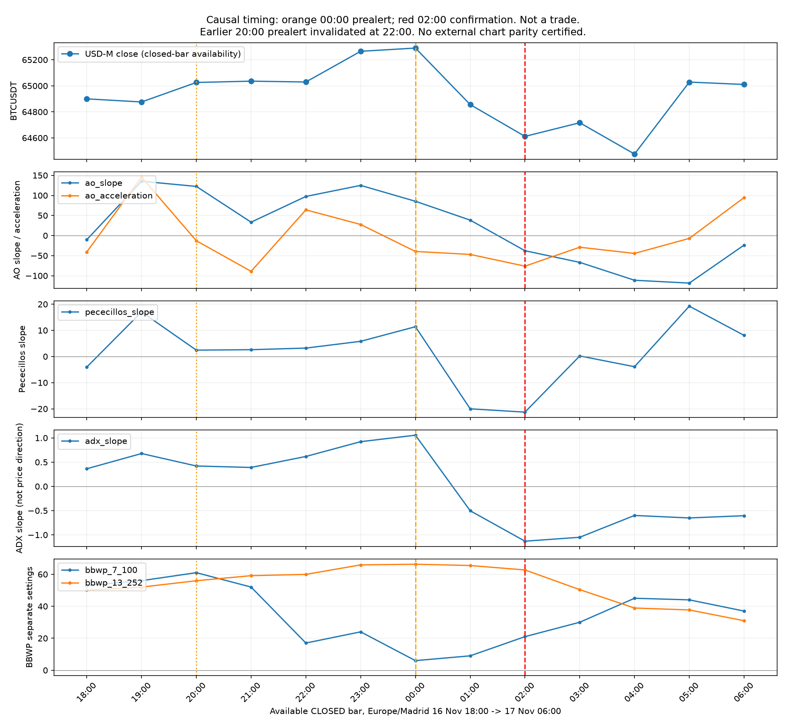
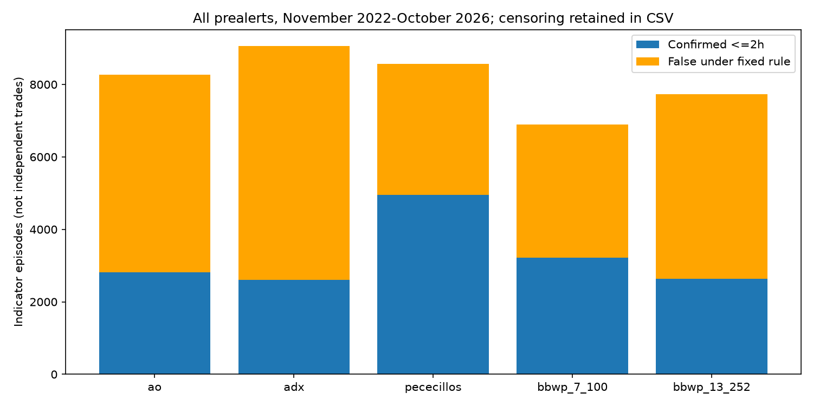

# I-GOD — ¿Llegamos tarde a los giros?

**Diagnóstico descriptivo. Sin estrategia nueva, sin rentabilidad calculada. PR #55 y su resultado NO EDGE permanecen intactos.**

## Respuesta sencilla

Sí: esperar a que cambie el signo de la pendiente llega después de la primera desaceleración. Anticiparlo tiene un coste: muchas desaceleraciones recuperan el impulso previo o no giran dentro de la ventana fijada. La confluencia añade otra espera cuando los indicadores no giran a la vez. Este diagnóstico no demuestra que entrar antes sea rentable.

## 1. Paridad: qué sabemos y qué falta

| Serie | Fórmula local auditada | Evidencia externa actual |
|---|---|---|
| AO | SMA5(HL2) − SMA34(HL2) | Sin exportación real verificable de TradingOne |
| ADX/DMI | DMI14 y RMA14 del DX; ATR14 separado | Sin exportación real y ajustes confirmados |
| Konkorde | Pececillos=tendencia+oscilador PVI; tiburones=NVI; roja=EMA15(tendencia) | Un punto visual comunicado por el propietario coincide redondeado: −40,40 Spot, 15Nov02Madrid apertura; no certifica todas las series |
| BBWP | Fuente pública The_Caretaker, SMA(close), rango literal previo | Original adjunto: valores por defecto 7/100. 13/252 es otro perfil solicitado, todavía sin configuración externa certificada |

**PARIDAD TRADINGONE: NO ESTABLECIDA para los cuatro indicadores.** La prueba local de fórmulas no sustituye datos externos. Falta ticker/venue, versión/ajustes, OHLCV de la misma fuente, prefijo de inicialización, exportación de series y semántica apertura/cierre. No se presupone que TradingOne sea TradingView. El valor puntual de pececillos es apoyo visual parcial aportado por el propietario, no una nueva medición independiente.

En las mismas 35.064 horas USD-M, BBWP 7/100 y 13/252 difieren una mediana de **14.68 puntos percentiles**, y coinciden en signo de pendiente solo **53.38%**. Correlación de nivel 0.686; coincidencias exactas 283/35064. Esto compara dos configuraciones, no dos plataformas. No hay desplazamientos temporales ajustados ni selección del perfil más favorable.

La fórmula literal ordena los anchos previos, calcula el índice derecho antes de insertar el actual y conserva el comportamiento de empates y calentamiento del código aportado. No se cambia por una definición distinta de percentil para acercar gráficos. 13/252 altera tanto la suavización como la referencia de ranking; no es un mero cambio de escala ni prueba de mejor anticipación.

## 2. Definiciones causales fijadas antes del recuento

Protocolo `IGOD_TURN_LATENCY_DIAGNOSTIC_V1`, commit previo `400264d`. Solo H1 cerradas. Se reutiliza el historial ya auditado USD-M, de noviembre2022 a octubre2026; calentamiento desde septiembre2022. Histórico exploratorio, sin holdout virgen.

- Pendiente: `d[t]=x[t]−x[t−1]`. Aceleración: `a[t]=d[t]−d[t−1]`.
- Prealerta: mismo signo no nulo, pero `abs(d[t])<abs(d[t−1])`. Solo el comienzo de cada tramo de desaceleración.
- Confirmación: cambio estricto de signo de pendiente, disponible al cierre actual. No se fecha en el vértice de la vela anterior.
- Invalidación: pendiente plana o recuperación del impulso anterior. Caducidad al cabo de dos horas sin giro. Final de datos incompleto se censura.
- La ventana fija de dos horas procede de la proximidad temporal anterior; no se escogió por el ejemplo. No se investigan otras ventanas para mejorar el resultado.
- AO/pececillos se estudian simétricamente UP/DOWN. ADX/BBWP describen fuerza/volatilidad y sus precios se muestran en ambas direcciones: no generan por sí solos LONG/SHORT.
- No hay Q75, cruce de cero, 2+2, filtro de contexto, ponderación ni combinación ganadora. No se generan operaciones.

## 3. Cuántas prealertas fallan

| Indicador | Prealertas | Giro confirmado ≤2h | Falsas según definición | % falsas entre resueltas | Censuradas | Antelación mediana / media, h |
|---|---:|---:|---:|---:|---:|---:|
| AO | 8272 | 2812 | 5459 | 66.00 | 1 | 1.0 / 1.34 |
| ADX | 9063 | 2604 | 6459 | 71.27 | 0 | 1.0 / 1.35 |
| Pececillos | 8564 | 4958 | 3605 | 42.10 | 1 | 1.0 / 1.16 |
| BBWP 7/100 | 6901 | 3224 | 3677 | 53.28 | 0 | 1.0 / 1.21 |
| BBWP 13/252 | 7732 | 2640 | 5092 | 65.86 | 0 | 1.0 / 1.25 |

Falsa significa que no se produjo ese giro bajo las reglas de invalidación/caducidad; **no significa pérdida de una operación**. Incluye por separado re-aceleración, plano y caducidad en `event_summary.csv`. Los números son episodios por indicador; no se suman como eventos independientes. Los giros sin prealerta también se conservan.

| Indicador | Todos los giros confirmados | Con prealerta | Plano/reversión en las siguientes 2h |
|---|---:|---:|---:|
| AO | 6115 | 2812 | 1992 |
| ADX | 5532 | 2604 | 1880 |
| Pececillos | 13246 | 4958 | 8047 |
| BBWP 7/100 | 10607 | 3224 | 6614 |
| BBWP 13/252 | 8058 | 2640 | 4441 |

Confirmado solo significa que cambió su pendiente; también puede volver a girar poco después. No certifica una reversión del precio. Los CSV incluyen ambos sentidos, años y todas las resoluciones, sin excluir las falsas.

## 4. Cuánto precio se mueve mientras esperamos

Referencia causal: al emitir la prealerta se congela el máximo ya visto para DOWN o mínimo ya visto para UP, desde el comienzo del tramo actual de pendiente. Es un extremo conocido, no el mejor vértice escogido mirando el futuro. Las mediciones siguientes usan los casos que sí confirmaron y la misma referencia para ambos cierres.

| Serie | N confirmadas | Distancia consumida mediana en prealerta | En confirmación | Deriva mediana entre ambos cierres, lado esperado |
|---|---:|---:|---:|---:|
| AO | 2812 | 0.623% | 0.838% | 0.172% |
| Pececillos | 4958 | 0.308% | 0.509% | 0.176% |

Este cuadro está condicionado a que el indicador acabó girando: no permite omitir las falsas ni afirmar una mejora operativa. La deriva puede ser negativa. Se incluyen p10/p25/p75/p90, medias y todos los casos en `price_distances.csv`; para ADX/BBWP se publican UP y DOWN por separado.

La excursión posterior usa un final común: cuatro horas después de la prealerta. Se excluye la propia vela de detección. La fracción consumida respecto al recorrido máximo usa un denominador ex-post, está etiquetada como descriptiva y jamás se usa para detectar ni anticipar un vértice. No se recortan valores negativos ni superiores a100%. Los casos incompletos no se rellenan con cero. La siguiente apertura es solo referencia temporal, no un fill garantizado. No se aplican costes porque aquí no hay operaciones ni PnL.

## 5. El caso 16–17 de noviembre, sin ajustar reglas

**Fuente: Binance USD-M; no se certifica que sea el ticker/configuración del gráfico de TradingOne.** El replay usa el prefijo histórico completo y una respuesta pública ya archivada por PR #55. Apertura y disponibilidad son distintas. La vela que abre23Madrid se conoce completa a00Madrid.

| Apertura Madrid | Cierre/disponibilidad Madrid | Cierre BTC | Δ AO | Δ² AO | Estado AO | BBWP7/100 | BBWP13/252 |
|---|---|---:|---:|---:|---|---:|---:|
| 11-16T22:00 | 11-16T23:00 | 65265.1 | 125.004 | 27.576 | CONTINUING_UP | 24.00 | 65.87 |
| 11-16T23:00 | 11-17T00:00 | 65290.0 | 85.418 | -39.586 | DECELERATING_UP | 6.00 | 66.27 |
| 11-17T00:00 | 11-17T01:00 | 64856.0 | 38.450 | -46.968 | DECELERATING_UP | 9.00 | 65.48 |
| 11-17T01:00 | 11-17T02:00 | 64611.6 | -37.761 | -76.210 | TURN_DOWN | 21.00 | 62.70 |

A23Madrid, el incremento AO +125 todavía era mayor que el anterior: no se podía conocer +85. La prealerta aparece a00Madrid (+85); a01Madrid sigue positivo pero más lento (+38); a02Madrid se confirma pendiente negativa (−37,761). Entrar/alertar con +85 a23Madrid supondría usar una vela aún abierta.

Entre prealerta00 y confirmación02, el cierre pasa de65.290,0 a64.611,6: **678,4USDT de precio, 1,039%**, no un beneficio ejecutado. El máximo conocido congelado en00 era65.500,2; la distancia ya recorrida desde esa referencia era0,321% en la prealerta y1,357% al confirmar. No se utiliza un máximo futuro.

En este mismo episodio, pececillos y ADX aceleraban hasta00 y giran directamente a01: esta definición no ofrece una prealerta justo antes de sus giros. BBWP7/100 gira a00 y BBWP13/252 a01; no representan la misma fase en cada hora. Exigir cuatro giros recientes implica esperar al más tardío. No se elimina esa espera proponiendo que una desaceleración sea ya un giro confirmado.

**También había una prealerta AO a20Madrid del16Nov que NO confirmó:** pasó de+135 a+122 y+33, pero volvió a acelerarse a22Madrid. Está conservada como falsa; no se muestra solo la prealerta posterior que sí acabó girando.

## 6. Conclusión y limitaciones

Hay dos fuentes distintas de retraso: el indicador necesita una nueva vela para demostrar el cambio de pendiente, y la confluencia espera varios cambios que no son simultáneos. Una prealerta permite observar antes la pérdida de impulso, pero no resolver de antemano si habrá giro: en esta definición las tasas de falsas son elevadas.

**No está justificado sustituir confirmación por prealerta como señal operativa.** Primero falta la equivalencia externa con TradingOne, especialmente el perfil real de BBWP. Los datos locales sí permiten explicar la secuencia y cuantificar su retraso bajo fórmulas públicas. No se elige un BBWP por menos falsas, no se recalculan resultados de PR #55, no se prueba una estrategia ni se declara edge.

Archivos: `hourly_values.csv.gz`, `prealerts.csv.gz`, `lifecycle.csv.gz`, `confirmations.csv.gz`, `event_summary.csv`, `price_distances.csv`, `diagnostic_20261116.csv`, `diagnostic_episodes.csv`, `source_audit.json`, `bbwp_comparison.json`, `reproduction.json`. El comparador nuevo permite añadir una exportación real sin sobrescribir evidencia; plantilla con metadatos pendientes, sin filas sintéticas presentadas como plataforma.

**SHADOW ONLY. TRADE AUTHORITY: NONE.**
