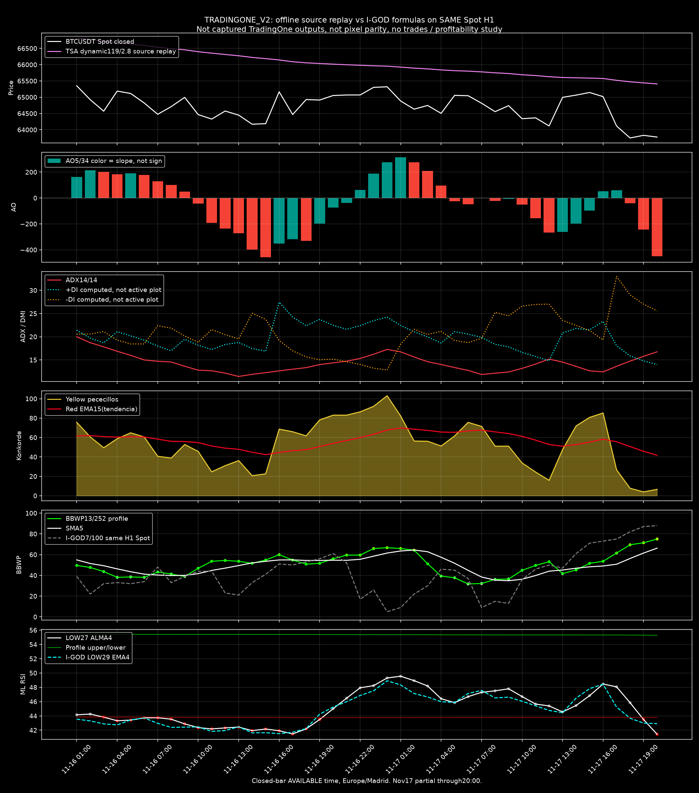
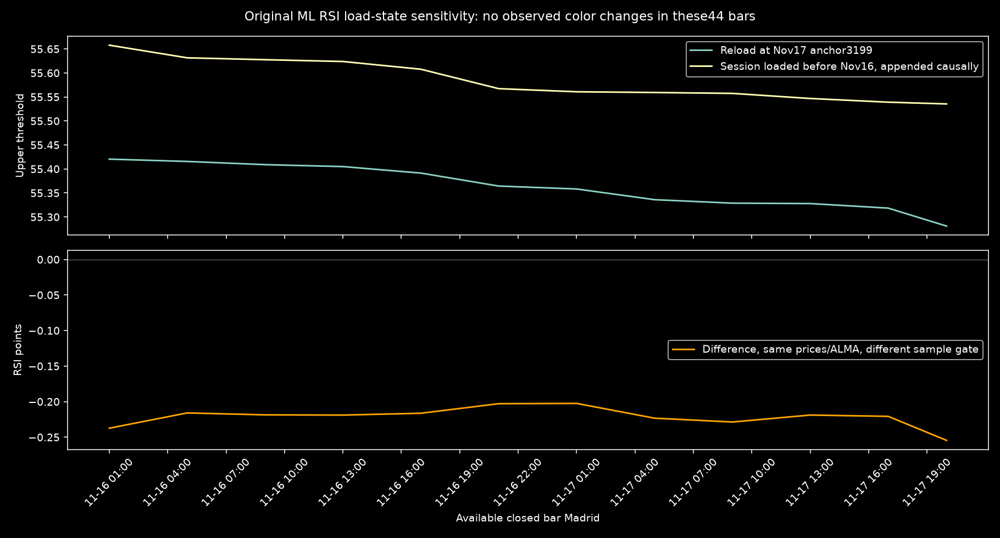

# TRADINGONE_V2 — perfil offline de configuración original

**Reproducción de fuentes y ajustes activos. Sin backtest de rentabilidad, operaciones ni cambios productivos. La paridad numérica externa con TradingOne todavía NO está certificada.**

## Qué se ha construido

Un perfil independiente con los seis Pine originales del JSON2.3.21, sus inputs activos y sus overrides visuales. Referencia SHA256 `516783defe6d16fd926c350f6bfdcd3cec9d6550b0d8230aa9d7036115015ac9`. Fuentes/ajustes declarados antes del replay en commit `a678a75`. No se incorporó ninguna versión OPT ni se modificaron fórmulas para encajar noviembre.

| Componente | TRADINGONE_V2 | Referencia I-GOD auditada |
|---|---|---|
| AO | HL2 SMA5−SMA34; verde si pendiente>0, rojo si≤0 | Misma fórmula; una barra plana roja no equivale a giro estricto bajista |
| ADX | DI14/ADX14, TR de Pine y fixnan | Misma longitud; los matices de seed se conservan separados |
| Konkorde | Las tres áreas originales; amarilla pececillos, roja EMA15(tendencia) | Research completo sí calcula las tres; `/bitman` usa mountain=tendencia para su geometría |
| BBWP | CLOSE SMA13/252, ranking literal y señal SMA5 | `/bitman`/research base7/100; Plan Diario13/252 con otras políticas de ranking/warmup |
| ML RSI | RSI27(LOW), ALMA4/sigma1/offset0; arrays/NA/orden del original BackQuantV5 | Observer LOW29/EMA4; Manual Copilot LOW27/EMA4 y Lloyd, no este perfil |
| TSA |119/2.8; ondas50, normalización100, From start | No equivalente TSA en los consumidores auditados; no se sustituye por SMA de V8 |

La matemática de AO/ADX/Konkorde reutiliza primitivas públicas ya auditadas. ML RSI se ejecuta con bucles literales: arrays con tres NA iniciales, push posterior, percentiles, grupos, igualdad PineV5 y break antes de reasignación. No se sustituye el resultado por una fórmula abreviada ni por un k-means correcto. Se mantiene también que maxData es un gate de carga y no una cola móvil que se vacía.

La roja de Konkorde NO es EMA15(pececillos). En el layout recibido solo se ven el área/línea amarilla de pececillos y la roja; tendencia y tiburones se calculan y se conservan en CSV, pero sus plots están ocultos. Los colores amarillos son estáticos de estilo, no una clasificación direccional.

## Datos reales utilizados

Descarga puntual, sin colector: Binance Spot oficial `https://data-api.binance.vision/api/v3/klines`, BTCUSDT H1. Se conservaron3200 velas cerradas, las cuatro respuestas originales, hora del servidor, recibos UTC y SHA256. Son hashes locales de los bytes recibidos, no checksums de archivo histórico firmados por Binance ni exportaciones de TradingOne.

El perfil principal utiliza **3199 velas cerradas**, desde `2026-07-07T12:00:00Z`, con último cierre disponible `2026-11-17T19:00:00Z`. Se controló la hipótesis de3200 barras totales incluyendo una abierta; el JSON no revela el prefijo real ni garantiza cómo TradingOne cuenta ese límite. Se publica esa incertidumbre y una comprobación con una vela adicional, sin seleccionar la inicialización que mejor quede.

La revisión16–17Nov contiene **44 velas**, por fecha de apertura Madrid; el17Nov es parcial hasta las20:00Madrid. Siempre se exportan apertura UTC/Madrid y cierre/disponibilidad UTC/Madrid. Ninguna vela futura o incompleta entra en la tabla de confirmados.

El JSON se guardó a18:17UTC; este replay controlado termina a19UTC. No se presenta como la copia del estado numérico de aquella pantalla. El índice final y el tiempo de carga también deberán igualarse cuando exista una exportación de valores.

I-GOD se recalculó **sobre esas mismas H1 Spot** para aislar diferencias matemáticas. Esto no es una lectura del bot desplegado. `/bitman` normalmente consume USD-M y marcos1H/4H/1D; el Plan Diario trabaja otros marcos. No se espera que un valor operativo4H/1D coincida con una H1 del gráfico.

## Comparación numérica del16–17Nov

| Campo del perfil | Referencia común H1 Spot | N | Error absoluto máximo | Error absoluto medio | Coincidencia signo pendiente |
|---|---|---:|---:|---:|---:|
| ao | igod_ao | 44 | 0 | 0 | 100.00% |
| adx | igod_adx | 44 | 3.19744e-14 | 1.12637e-14 | 100.00% |
| plus_di | igod_plus_di | 44 | 1.06581e-14 | 4.84461e-15 | 100.00% |
| minus_di | igod_minus_di | 44 | 1.42109e-14 | 5.81353e-15 | 100.00% |
| roja | igod_red | 44 | 2.13163e-14 | 7.4284e-15 | 100.00% |
| pececillos | igod_mountain | 44 | 9.59636 | 4.21554 | 93.18% |
| bbwp | igod_bbwp7 | 44 | 61.6667 | 15.9058 | 56.82% |
| bbwp | research_bbwp7 | 44 | 61.6667 | 15.9058 | 56.82% |
| bbwp | daily_bbwp13 | 44 | 0 | 0 | 100.00% |
| bbwp_signal | daily_bbwp_signal | 44 | 0 | 0 | 100.00% |
| ml_value | igod_ml29 | 44 | 2.82845 | 0.684641 | 84.09% |
| ml_value | ema27_smoothing_only | 44 | 2.62673 | 0.585927 | 84.09% |

Errores del orden1e−14 son redondeo de coma flotante en esta comparación Python. No son una prueba externa de Pine. Pececillos frente a mountain compara dos series diferentes deliberadamente; su diferencia NO es un fallo de tolerancia. EMA27_smoothing_only aísla el filtro de suavizado: no finge reproducir el clustering completo de Manual Copilot.

En estas44 velas, la función13/252/SMA5 de Plan Diario coincide numéricamente con el perfil. Eso no elimina las diferencias de empates/warmup advertidas: esta muestra madura no demuestra equivalencia para datos planos o iniciales. Tampoco convierte una prueba H1 Spot en el resultado del servicio diario USD-M.

El ML RSI del perfil y el observer I-GOD29/EMA difieren de color en **4/44** velas. Coincidencia 90.91%. Son comparaciones de dos cálculos offline, no aciertos ni rentabilidad y no valores exportados del runtime de TradingOne.

| Cierre disponible Madrid | ML RSI27 ALMA | Color perfil | ML RSI29 EMA | Color referencia |
|---|---:|---|---:|---|
| 2026-11-16T01:00:00+01:00 | 44.153 | NEUTRAL | 43.540 | RED |
| 2026-11-16T02:00:00+01:00 | 44.253 | NEUTRAL | 43.299 | RED |
| 2026-11-16T19:00:00+01:00 | 43.495 | RED | 44.241 | NEUTRAL |
| 2026-11-17T18:00:00+01:00 | 45.845 | NEUTRAL | 43.677 | RED |

## Secuencia del16Nov23Madrid

El ejemplo previamente estudiado usaba una fuente USD-M. Ahora se usa Spot explícitamente; no se fuerzan los mismos incrementos exactos. El perfil confirma que una pérdida de pendiente puede preceder al giro, pero no convierte esa desaceleración en una orden o señal de entrada.

| Apertura Madrid | Disponible Madrid | Δ AO Spot | Δ pececillos | Δ ADX | BBWP13/252 | Δ BBWP | BBWP7/100 referencia |
|---|---|---:|---:|---:|---:|---:|---:|
| 11-16T22:00 | 11-16T23:00 | 126.856 | 5.694 | 0.904 | 65.873 | 6.349 | 26.000 |
| 11-16T23:00 | 11-17T00:00 | 87.356 | 10.890 | 1.044 | 66.667 | 0.794 | 5.000 |
| 11-17T00:00 | 11-17T01:00 | 39.218 | -20.857 | -0.530 | 65.873 | -0.794 | 9.000 |
| 11-17T01:00 | 11-17T02:00 | -38.597 | -25.830 | -1.102 | 64.286 | -1.587 | 22.000 |
| 11-17T02:00 | 11-17T03:00 | -68.448 | -0.207 | -1.024 | 51.190 | -13.095 | 30.000 |

A00Madrid, BBWP13/252 todavía sube de65,873 a66,667, mientras7/100 cae de26 a5. La interpretación de expansión/contracción cambia por configuración. A01Madrid, pececillos/ADX/BBWP13 ya descienden y AO todavía aumenta, más despacio. El AO cambia de signo de pendiente a02Madrid. No se añade un gate de simultaneidad ni se escoge un instante de entrada.

ML RSI también conserva diferencias de fase: a01Madrid, ALMA27 todavía aumenta respecto a00, mientras EMA29 ya disminuye. Ambos permanecen NEUTRAL bajo sus propios thresholds en ese instante. No puede asumirse que ALMA4 sea siempre una versión más rápida de EMA4.

## Inicialización, directo y recarga

1. **Mismo prefijo y mismo anclaje:** replay repetido exacto en los valores/thresholds ML RSI. Las pruebas de prefijo con anclaje fijo y las8 comprobaciones reales conservan los valores cerrados al añadir un dato posterior.
2. **Sesión persistente frente a reload:** se fija una sesión antes del16Nov a `2026-11-15T23:00:00Z` y se añaden cierres cronológicamente. Rehacer la carga al17Nov cambia el gate inicial y el conjunto de muestras del ML RSI. Diferencia máxima observada en threshold superior **0.254515**; cambios de color en las44 velas: **0**. No se inventa un cambio de color donde no lo hubo.
3. **Histórico redibujado no es evidencia forward:** variar last_bar_index al recargar puede revisar thresholds de horas anteriores. El cálculo cargado no es estrictamente invariante al prefijo si cambia su punto final. El RSI y ALMA usan precios pasados; la elegibilidad del array depende además del contexto de carga. No se elimina ese comportamiento del original ni se presenta el histórico recargado como emisiones reales del pasado.
4. **Origen de historial:** se compara la barra adicional declarada, sin ajustar el inicio por coincidencias visuales. En44 velas, diferencia máxima ML value 0.0 y threshold superior 0.00020601405715581222. No prueba todos los prefijos posibles. PVI/NVI, EMA dinámica, ondas TSA y muestra ML dependen del prefijo/carry; sin el prefijo real de TradingOne no hay golden externo certificado.
5. **Snapshot provisional público real:** recibido `2026-11-17T19:28:26.292086+00:00`, vela abierta `2026-11-17T19:00:00Z`. Sus precios estaban disponibles a esa hora, pero el cierre futuro no lo estaba. La preview usa rollback y deja intacto el estado confirmado. Esto comprueba la mecánica local con un GET real; NO verifica el motor de TradingOne ni demuestra una captura continua.
6. **TSA:** se preserva el uso del trend actual en las condiciones y la suma adicional de speed tras el reset, sin corregirlos por intuición. Hay supuestos de built-ins/HMA y de evaluación de speed que requieren registros externos. El histograma TSA está oculto en tu layout; su tendencia y coloración de velas no son señales certificadas.

## Qué falta para certificar paridad externa

- Una exportación REAL de TradingOne con los resultados ejecutados por vela: AO, ADX/DI, las cuatro series Konkorde, BBWP/SMA5, RSI/ALMA/thresholds/colores, Dynamic Trend/Trend Speed y sus timestamps.
- OHLCV de la misma fuente, instrumento Spot inequívoco, primer bar cargado, cantidad real de barras, last_bar_index y hora de captura; declarar cuál era la barra abierta.
- Más precisión que dos decimales cuando se quieran certificar pendientes, cruces o igualdad con thresholds; el redondeo puede ocultar diferencias de signo.
- Contraste del intérprete TradingOne2.3.21: NA/arrays/percentiles PineV5, all-NA indexof, HMA5, lectura de speed antes de su reasignación, redondeo del gradiente y aplicación de los overrides. Los tests internos no sustituyen esto.
- Una sesión real antes/después de recargar o varios snapshots intrabar del mismo bar. No se han ejecutado estos Pine en TradingOne durante la tarea ni se han fabricado sus resultados.

**Estado: perfil offline implementado y probado bajo semántica explícita; PARIDAD NUMÉRICA TRADINGONE NO CERTIFICADA.** No se declara edge, mejora de timing operativo o autorización de integración. Los resultados negativos anteriores permanecen intactos.

Archivos completos: `profile.json`, `source_manifest.json`, los seis `sources/*.pine`, port literal `backquant.py`, `profile.py`, datos públicos/recibos en `data/`, `hourly.csv.gz`, `nov16_17.csv`, `comparison.csv`, `reload.csv`, `provisional.json` y `summary.json`.

**SHADOW ONLY. TRADE AUTHORITY: NONE.**
