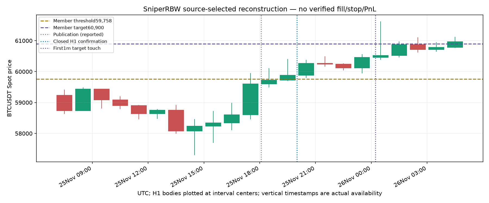

# I-GOD PR #58 — addendum de fuentes25–26 de noviembre y consolidación

**Investigación retrospectiva seleccionada, sin ventaja económica demostrada.** La prioridad operativa de esta entrega es revisar las PR #59 y #60 de notificaciones; aquí no se conecta ninguna nueva señal a producción.

## Qué evidencia tenemos

Se leyeron completos los informes suministrados18–24Nov, directo23Nov, auditoría26Nov, síntesis del directo25Nov y configuración TradingOne2.3.21. Son notas derivadas de revisión externa: no Telegram original, transcripción íntegra, fotogramas ni fills. Las dos nuevas notas se conservan en s/audit26.md y s/live25.md con hashes exactos del plan. Los hashes de las anteriores/configuración están en plan.json. Ninguna consulta adicional a vidIQ: **0 llamadas y 0 créditos**. El manual de JohnJ.Murphy no está disponible localmente: no afirmamos haberlo leído ni verificamos páginas/citas.

| Procedencia | Qué documenta | Qué no demuestra |
|---|---|---|
| Bitman, directo25 a30:10–32:58 | Volatilidad semanal relacionada con amplitud; no dirección | Umbral predictivo, causalidad ni tasa de acierto |
| Bitman,33:52–35:00 | Interpretación de área Konkorde semanal cruzando cero | Identidad inequívoca del área o regla del mínimo |
| Bitman,52:20–53:45 | Diario: BBWP decreciente,tres barras verdes del AO, ADX todavía creciendo, Konkorde negativo | Confirmación diaria simultánea; parte del comentario es intravela |
| Bitman,55:26–56:46 | Declaración de SHORT RSI25Nov antes de57300 | Hora/mercado/entrada/stop/costes/PnL; timestamp del vídeo no es hora del mercado |
| Directo del 24,1:12:51–1:13:26 | Close/SMA13/252 verbalizados y extremos98/2 | Identidad completa del indicador retocado o señalSMA5 |
| SniperRBW, mensaje derivado25Nov19:04Madrid | H1close>59758,target60900 | Stop/fill/posición real; no es señal de Bitman |
| Jordi/TSS2 y nueva cita del miembro | Impulso con volatilidad>50; salidas por volatilidad/Konkorde;continuidad 4H | Estrategia oficial ni definición completa de confirmación |
| Nuestra implementación | Fractales causales, observación secuencial, costes y gestión PAPER | Equivalencia privada de indicadores o rentabilidad futura |

No convertimos los porcentajes o recorridos citados por el autor en tasas verificadas. Fred, FE, TSA privado y el anclaje2W siguen con sus limitaciones anteriores. AO/ADX/Koncorde públicos y BBWP 13/252 son proxies auditadas; **EXACT BITMAN PARITY: NOT PROVEN**.

## Integración con lo existente y preservación

Plan sellado antes de la nueva captura/comparación: commitec6e877, SHA256a433c6db1c64e7a662bff504e3b191a97eb9bcf2d53e8c52363a4491ce465b39. No cambia el detector, sus entradas, indicadores ni el simulador original. El addendum ocupa únicamente seq/a26/. El replay anterior18–24Nov, sus1.835 registros, cadenas hash, resultados, ZIP y fuentes permanecen exactamente iguales; el nuevo replay comprueba igualdad completa del prefijo antes de exportar. Se añaden573 registros, no se reescribe el pasado.

Datos públicos Binance BTCUSDT **SPOT**, corte26Nov07:00UTC, únicamente cierres. Prefijos originales exactos; cuatro nuevos GET públicos con solapamiento cotejado y780minutos del episodio25Nov. Total3.384velas15m,1.846H1,611H4,602D1,480W1; incrementos184/46/11/2/0. BytesHTTP, petición/recepción, URLs/parámetros y SHA256 en d/manifest.json/receipts.json. No datos de cuenta ni credenciales. SHORT sintético: no se presenta como préstamo Spot ni ejecución de futuros. Funding Spot no aplicable; financiación/mark/liquidación/funding de futuros no modelados como cero.

### Secuencia diaria y modalidades

out/daily.csv conserva BBWP/slope, AO/slope, ADX/slope, pececillos/slope, estructura y memoria de giros con hora de cierre. Se separa recuperaciónAO de giroADX: ADX creciente no se hace pasar por confirmación de rebote. BBWP y ADX no asignan dirección. Estos son tokens descriptivos, no un filtro de entrada nuevo.

En las15 entradas congeladas, contexto cerrado4H+D1 según DMI y close/TSA:6WITH_TREND,7COUNTER_TREND,2MIXED. Ninguna entrada se elimina por esa clasificación. Un rebote contra tendencia se identifica como tal; no se transforma en cambio confirmado de la tendencia mayor. La nueva afirmación del miembro excluye retrocesos, por lo que no puede atribuirse al mismo modelo que deliberadamente estudia ambos modos.

## Reconstrucción SniperRBW

- Publicación reportada:25Nov19:04Madrid=18:04UTC; nivel59758.
- Primer cierreH1 posterior por encima:25Nov21:00Madrid=20:00UTC, **59879.23**, idéntico al valor reportado. La vela cierra entonces; no hay señal conocida desde su apertura.
- Primer minuto posterior cuyo high alcanza60900:26Nov**01:13–01:14Madrid**, equivalente00:13–00:14UTC. No se adjudica un segundo exacto dentro del minuto ni fill.
- El objetivo fue alcanzado después del gatillo; sin stop/fill/costes de esa operación no es posible calcular PnL. El nivel bajista57456 mencionado después del hecho no se evalúa como predicción previa.

## RSI: tres referencias y dos implementaciones sin buscar una coincidencia ganadora

Se conservan todas las velas del tramo 18–26 de noviembre y de los días 5 y 22, junto con sus estados y transiciones, en out/rsi.csv. TradingOne originalLOW27/ALMA4sigma1offset0 y operativoLOW29/EMA4V4 se ejecutan con los mismos LOWSpot y anclaje de carga. No se cambia MLRSIoperativo ni se identifica el RSI privado de Bitman. El resultado original del5Nov/22Nov sigue intacto: GREEN22Nov13UTC, ya verde a17Madrid, no un nuevo cruce a esa hora; RED5Nov17UTC. Las tres declaraciones no son una cohorte independiente y las horas de los dos SHORT permanecen desconocidas.

Transiciones completas del25Nov en cualquiera de las dos implementaciones:

| Fecha UTC del cierre | Original LOW27/ALMA4 | Operativo LOW29/EMA4/V4 sobre el mismo Spot |
|---|---|---|
| 2026-11-25T05:00:00+00:00 | RED (42.4260975509733) | NEUTRAL (43.1816949482351) |
| 2026-11-25T07:00:00+00:00 | NEUTRAL (42.5007932120224) | NEUTRAL (43.057821470229904) |
| 2026-11-25T08:00:00+00:00 | RED (42.00519594623486) | RED (42.196456336256084) |
| 2026-11-25T19:00:00+00:00 | RED (42.28572934225083) | NEUTRAL (44.4921787292198) |
| 2026-11-25T20:00:00+00:00 | NEUTRAL (46.11587534881929) | NEUTRAL (47.28681877153225) |
| 2026-11-25T23:00:00+00:00 | GREEN (53.19675799951501) | NEUTRAL (52.0551905758716) |

Una coincidencia de color no confirma contrato/fórmula/entrada del autor. No se elige la transición más próxima al mínimo57300 ni se adjudica el3.13% declarado.

## Volatilidad semanal y magnitud

Misma BBWP 13/252, sin nuevos parámetros ni búsqueda de buckets. Grupos predeclaradosALL/RISING/NON_RISING/TURN_UP y horizontes1/2/4semanas. Se mide magnitud sin AOdireccional ni señales de entrada. Todas las observaciones se solapan y pertenecen a histórico examinado; son descriptivas, sin IC de validación ni interpretación causal.

| Grupo BBWP semanal | Horizonte | n | Retorno absoluto medio/mediano | Excursión absoluta media/mediana | Excursión media/ATR |
|---|---:|---:|---:|---:|---:|
| ALL | 1W | 213 | 4.67% / 3.41% | 7.84% / 6.56% | 0.852 |
| ALL | 2W | 212 | 7.12% / 4.82% | 11.36% / 9.27% | 1.236 |
| ALL | 4W | 210 | 10.63% / 7.76% | 16.53% / 13.89% | 1.800 |
| RISING | 1W | 109 | 4.24% / 3.19% | 7.44% / 6.46% | 0.815 |
| RISING | 2W | 109 | 6.48% / 4.22% | 10.50% / 8.60% | 1.150 |
| RISING | 4W | 109 | 9.20% / 6.23% | 15.23% / 12.09% | 1.650 |
| NON_RISING | 1W | 104 | 5.11% / 3.89% | 8.26% / 6.67% | 0.890 |
| NON_RISING | 2W | 103 | 7.80% / 5.86% | 12.28% / 9.76% | 1.328 |
| NON_RISING | 4W | 101 | 12.16% / 9.48% | 17.94% / 15.91% | 1.962 |
| TURN_UP | 1W | 30 | 4.44% / 3.07% | 7.91% / 6.33% | 0.867 |
| TURN_UP | 2W | 30 | 7.39% / 4.97% | 10.81% / 8.59% | 1.183 |
| TURN_UP | 4W | 30 | 12.32% / 9.53% | 17.63% / 15.56% | 1.909 |

En estos datos la media de excursión1W deRISING es menor que la deNON_RISING; no respalda la afirmación universal de que nuestra proxy creciente anticipe siempre un recorrido mayor. No invalida ni certifica el indicador privado. PR30EXPANSION EFFECT FRAGILE y las limitaciones dePR31 permanecen intactas.

## Comparación de salidas sobre exactamente las mismas entradas

15 entradas, cantidades, precio, stop inicial y costes idénticos por fila. Políticas fijadas en plan.json. La ATRbaseline se reproduce exactamente frente al simulador existente para las14 operaciones cerradas. Ningún ajuste del detector ni selección de la gestión ganadora. Los dos nuevos exits de indicador deciden en H1 cerrado y actúan en siguiente apertura15m, nunca retrospectivamente en el interior de esa vela. Stopgap prevalece. Mismo15m tocandoTP/stop: adverse-first. TP1original+1%precio,50%; stops nunca se amplían; BE del runner incluye costes. Estructural utiliza los fractales ya conocidos de Frame,2barrasderechas, con buffer.2ATR; se hace efectivo en la barra posterior y puede incorporar un retraso adicional15m respecto a la primera publicación del fractal.

| Política | Completadas | Abiertas/censuradas | Neto realizado en cerradas (USDT) | Marcado de las15 operaciones (USDT) |
|---|---:|---:|---:|---:|
| BASELINE_ATR | 14 | 1 | -142.8420 | -134.6709 |
| BBWP_TURN_EXIT | 14 | 1 | -123.9000 | -115.7288 |
| KONCORDE_CROSS_EXIT | 14 | 1 | -178.3038 | -170.1326 |
| TP1_NET_BE | 13 | 2 | -179.8540 | -153.6437 |
| TP1_STRUCTURE | 14 | 1 | -132.3847 | -124.2135 |

Son contrafactuales emparejados independientes, **no cinco portfolios compuestos comparables**: las duraciones pueden solaparse y algunas operaciones siguen abiertas. Las diferencias de censura impiden ordenar políticas por neto cerrado. El marcado incluye remanente, sin fingir comisión de salida todavía no realizada. Comisión 0,1 % por fill y slippage 0,05 % por fill son supuestos conservadores documentados; no tarifa personal verificada.

Baselineextendido:14 cerradas,7 LONG y 7 SHORT, neto **−142.8420USDT**; una SHORT abierta, equity marcado9865.3291 desde10000, DDmáximomarcado2.0471%. Que9/14 cierren positivas no demuestra esperanza positiva. Los eventos fallidos27INVALIDATED,16EXPIRED y4rechazos se mantienen. El resultado antiguo−130.0141no se sustituye: corresponde al corte anterior.

## Nueva cita: impulso1H/continuidad4H — hipótesis prioritaria, todavía incompleta

La cita literal suministrada se conserva separada en member.json; no es una regla oficial de Bitman ni un cambio del plan sellado. La semántica de impulso/agotamiento es compatible en términos generales con las notas. No están demostradas la confirmación exactaAO, la serie/cruce deKoncorde, la fuerzaADX necesaria ni la regla de continuidad4H. La exclusión de todos los retrocesos procede del miembro, mientras que las fuentes anteriores también describen rebotes y correcciones: se documenta esa diferencia, no se borra.

El ángulo de pantalla no es invariante. Si y=s_y·ADX,x=s_x·horas, entonces tan(ángulo)=(s_y/s_x)·ΔADX/Δhora; zoom/escalas cambian la apariencia.90°literal implica pendiente vertical indefinida; «o más» no proporciona un umbral unívoco creciente. Traducción segura: **ΔADXenpuntos/H1** y **Δ²ADXenpuntos/H1²**, registrar nivel yDMI; ningún umbral angular inventado. member.py devuelve esos observables, BBWP proxy>50 y contexto cerrado, pero AO_CONFIRMATION / KONCORDE_CONFIRMATION=UNSPECIFIED. No emite señales ni confirma entradas.

| Investigación | Qué probó realmente | Diferencia con la cita |
|---|---|---|
| PR33entradasintraday | AOsolo/contexto/ADX/FE y salidas prefijadas;28NO EDGE,7INCONCLUSIVE | No identidad de confirmación privada ni combinación completaBBWP>50 |
| PR46/49 | Cruceárea/EMA, ADX>40ydescenso, AOdospendientes, BBWP7/100>85 | Serie/volatilidad/distinción agotamiento≠impulso de la nueva cita |
| PR50/51 | Agotamiento, inicio, rebote fallido2+2y1+1;Q75primario;DMIenP2 | No un único impulso1H+BBWP 13/252>50;NO TESTABLE/controlporrégimen elimina supuestoedge |
| PR52–54 | Observación y metodología; no captura activada | Insuficiencia estructural; no validación prospectiva iniciada |
| PR55 | TP1/BE/trail con6configuraciones declaradas | NO EDGEconservado; no combinación privada exacta |
| PR57 | PerfilTradingOneV2 | Auditoría matemática/latencia, no rentabilidad |
| PR #58 | Motorsecuencial con estructura15m;ADX/BBWP/contextodescriptivos | No filtro obligatorioBBWP>50 ni continuidad4H; no5m |

**Comparación fuera de muestra de la combinación textual: NO EJECUTADA.** No tenemos una especificación numérica completa ni datos históricos vírgenes; noviembre está seleccionado y observado. No se reutiliza este addendum como holdout. Costes, MAE y resultados adversos de las simulaciones existentes quedan disponibles, pero no validan esta regla distinta. Para una futura evaluación independiente hará falta congelar las definiciones faltantes, costes/funding/entrada/invalidación, referencias comparables y fecha de observación sin importar señales históricas. Refinar a15m / 5m puede reducir o aumentar falsos positivos, costes y latencia; no se presume mejor. No se descarga5m ni se activa un colector.

## Protección de capital y límites

La evidencia de stop no verificado yAMBIGUOUS_POSITIONS se conserva como fallo de verificación. GuardianOnline/Telegramavisando no equivalen a un stop registrado y cubriendo el remanente en Bitunix. Esta investigación no lee cuentas privadas ni repara órdenes. El simulador mantiene1posición,noaveraging,cap1x,riesgo.5%,DD5%latched,stop/invalidation yfees. La lógica realGuardianV2,V8,readiness900,MLRSI,mercadodedatos yprotocoloWeeklyV1 no cambian.

En paralelo, PR #59 y #60 proponen el radar silencioso: FSMpersistente, avisosPRE/confirmación/invalidez y seguridad por cambios; manual intacto. PermanecenDISABLEDsinrollout. El mensaje de un miembro no se conecta a ese radar ni aejecución.

## Conclusión y próximo paso

**SOURCE ALIGNMENT ONLY — ECONOMIC EDGE NOT ESTABLISHED.** La reconstrucción gana trazabilidad, no rentabilidad demostrada. Snipercoincide en precio y cronología, pero carece deejecuciónverificada. Gestión yvolatilidadsemanal no autorizan elegirconfiguraciónganadora. La nueva hipótesis de impulsos sigue priorizada conbloqueos explícitos, sin probarcombinaciones equivalentes otra vez.

Revisar primero la política de notificaciones y comprobar la protección real directamente en el exchange si existe exposición. Completar la evidencia numérica original sin más optimizaciones. Sin activación continua, sin Telegram real, órdenes, merge ni deploy. SHADOW ONLY. TRADE AUTHORITY: NONE.

Las 200 observaciones H1 de la nueva hipótesis están en [member.csv](out/member.csv), con todas las confirmaciones desconocidas marcadas explícitamente; no son 200 señales.

La CI numérica instala NumPy y ejecuta las 15 pruebas del addendum; el workflow mínimo de V8, que no instala NumPy, omite solamente ese módulo numérico según la separación existente. No se omiten los guards de V8 ni sus pruebas operativas.
