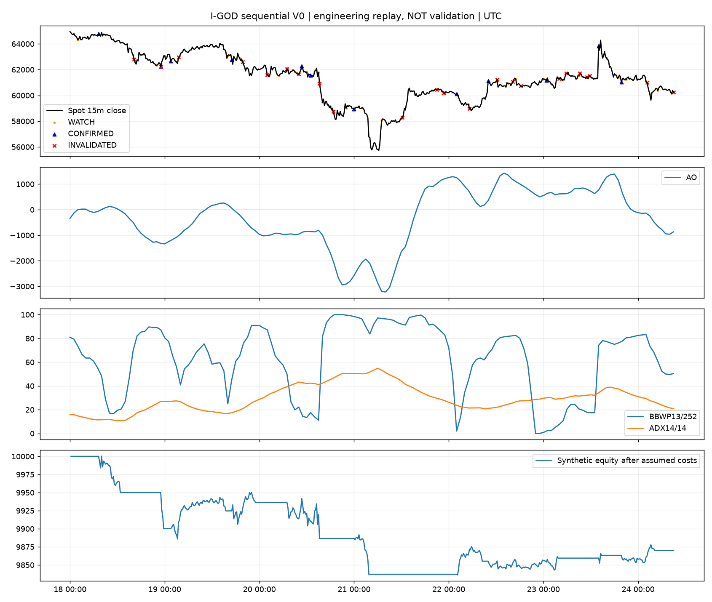
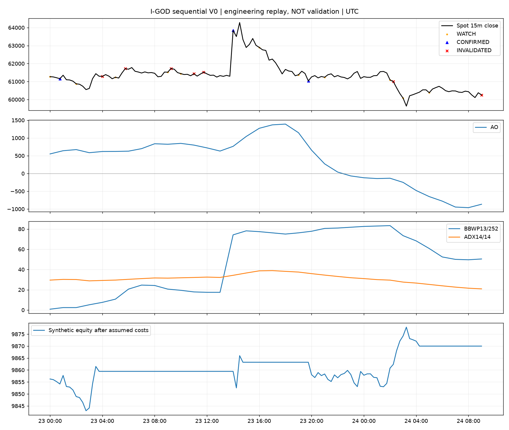
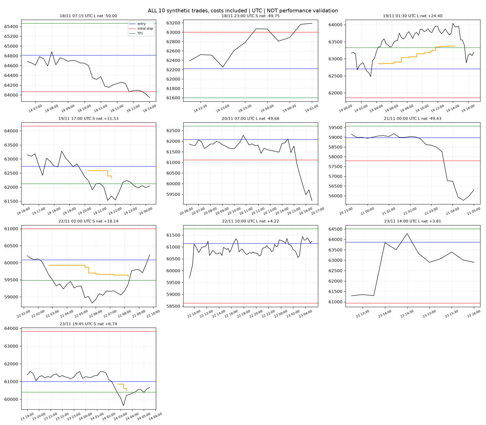

# I-GOD — motor secuencial SHADOW V0

**Prototipo funcional; ninguna ventaja demostrada. No desplegado.**

## Fuentes y alcance
Se leyeron completos los dos documentos aportados. Son auditorias derivadas y un resumen basado en subtitulos recuperados; no tenemos mensajes, capturas, subtitulos originales ni fills. El acceso directo al video no fue recuperable. No se atribuyen las hipotesis propias a Bitman. Ver evidence.json y los hashes de spec.json/sources.json. No se publican las secciones personales de posicion/cuenta del dossier.

Base PR57 0017faf; declaracion daa8673 y addendum19a2f57 anteriores a resultados. Nuevo codigo solo bajo research. PR55 mantiene NO EDGE, PR50 NO TESTABLE y la paridad completa TradingOne permanece NO CERTIFICADA. No se alteran las investigaciones ni formulas previas.

## Que se reutiliza y que falta
| Elemento | Implementacion y limite |
|---|---|
| AO/ADX/Konkorde | Kernels auditados: HL2 SMA5/34, DMI14/14, pececillos/tendencia/tiburones/EMA15 separadas. No proxies privados certificados. |
| BBWP | CLOSE SMA13/252 y SMA5. Giro de fuerza/volatilidad no decide direccion. |
| Trend Speed | Fuente TSA del propietario119/2.8/50/100, con licencia CC BY-NC-SA4.0. No es la configuracion117/2.8/150/100 de Hermi ni certificacion del TS de Bitman. |
| Fred | No hay definicion cuantitativa suficiente. Se registran curvas/pendientes/cambios, pero NO se inventa una senal Fred. |
| FE | No verificado, excluido. |
| 2W | Anclaje lunes1970-01-05 declarado; no certificacion de calendario del grafico. Solo cierres; BBWP2W UNKNOWN por warmup insuficiente. |
| Fractales | Hipotesis explicita2+2; confirmados dos barras despues. Nunca se operan retrospectivamente los vertices. |
| Rechazo/retest | Niveles previamente disponibles, cierre y posterior retest; linea TSA del cierre anterior. Son reglas de investigacion. |

## Motor de secuencias
Contexto cerrado2W/1W/1D/4H/1H/15m por timestamp de disponibilidad. WATCH independiente por lado ante desaceleracion/giro AO1H; expiracion2h, oposicion invalida. Confirmacion requiere pendientes AO/pececillos alineadas y break/retest15m de fractal conocido. ADX, BBWP y contexto se registran sin imponer filtros direccionales nuevos. Agotamiento se registra por giro opuesto AO o enfriamiento ADX+BBWP; no se inventa una salida volatilidad literal del video.

La recuperacion se registra en unidades del indicador y desplazamiento del precio/ATR por separado. Las secuencias diarias guardan timestamps de giros, sin afirmar que el orden historico constituya una senal validada. Cada senal conserva razones, precios y latencia. Todas las prealertas fallidas y oportunidades rechazadas permanecen en el ledger.

## Datos y coherencia temporal
Binance BTCUSDT Spot publico, GET sin credenciales. Corte24Nov2026 09UTC (10Madrid). Replay18Nov00UTC–24Nov09UTC:612 barras15m,153 horas. No es todo el24Nov. Calentamiento:3200x15m,1800x1H,600x4H,600x1D,480x1W;240x2W derivados. OHLCV, horarios, continuidad, cierre y SHA verificados. Recibos originales y URLs en d/.
Concordancia de agregacion15m: {'1h': 800, '4h': 199, '1d': 32, '1w': 4, '2w': 2}. Los cambios de marco se conocen solo al cerrar. Las marcas de disponibilidad son modeladas, no emisiones reales de esos dias. No se usa la vela actualmente abierta.

Documentacion oficial: [klines Binance](https://developers.binance.com/en/docs/catalog/core-trading-spot-trading/api/rest-api/market) y [limites de repainting](https://www.tradingview.com/pine-script-docs/concepts/repainting/). Las limitaciones de carga/recarga de TradingOne/ML RSI de PR57 permanecen vigentes.

## Contraste de afirmaciones de mercado del dossier
| Disponibilidad Madrid | Serie | Informe | Replay | Diferencia |
|---|---|---:|---:|---:|
| 18/11 13:00 | 1h close | 64231.52000 | 64231.52000 | 0.00000000 |
| 19/11 11:00 | 1h close | 63857.89000 | 63857.89000 | 0.00000000 |
| 23/11 05:00 | 4h ao | -716.44000 | -716.44403 | -0.00402941 |
| 23/11 13:00 | 4h ao | -219.79000 | -219.78668 | 0.00332353 |
| 23/11 17:00 | 4h ao | 200.90000 | 200.89597 | -0.00402941 |
| 24/11 09:00 | 4h ao | 412.35000 | 412.35006 | 0.00005882 |
| 24/11 09:00 | 1h ao | -961.99000 | -961.99282 | -0.00282353 |
| 24/11 09:30 | 15m close | 60108.75000 | 60108.75000 | 0.00000000 |

8/8 referencias de precio/AO coinciden al redondeo informado. Esto contrasta esos valores de mercado, NO certifica los otros indicadores, mensajes o resultados de una operacion.

## Contexto cerrado final y cruce semanal
| Marco / disponible Madrid | AO / pendiente | ADX / pendiente | Pececillos / roja | BBWP / pendiente |
|---|---|---|---|
| 1h · 24/11 10:00 | -865.909 / 96.084 | 20.871 / -0.660 | 9.283 / 36.766 | 50.397 / 0.794 |
| 4h · 24/11 09:00 | 412.350 / -109.939 | 28.937 / -2.083 | 66.420 / 61.862 | 69.841 / -4.365 |
| 1d · 24/11 01:00 | -12554.190 / 375.501 | 49.019 / 0.086 | -8.821 / 1.533 | 90.873 / -2.778 |
| 1w · 23/11 01:00 | 968.525 / -4094.350 | 24.847 / 1.073 | -6.569 / 69.193 | 51.587 / 30.159 |
| 2w · 23/11 01:00 | -5310.949 / -1269.992 | 18.180 / 0.525 | 26.100 / 47.075 | UNKNOWN / UNKNOWN |

Ultimo1W: pececillos=-6.569 y zero_event=-1.0; tendencia=31.420 y zero_event=0.0; tiburones=-9.964 y zero_event=0.0. El cruce de pececillos descendente esta disponible23Nov00UTC. No identifica por si solo el area privada usada en el directo ni certifica que el minimo ocurra en esa semana.

En2W el minimo de la ultima vela no tiene dos velas derechas cerradas: no se declara un pivote ni una convergencia confirmada sobre ese extremo. Una lectura visual provisional sigue siendo provisional.

## RSI1H del5 y22 de noviembre
Se reconstruye el original LOW27/ALMA4/sigma1/offset0, con1800 cierres de inicializacion declarados, no OPT. El directo habla de futuros: este replaySpot no prueba ni refuta esa senal privada. rsi.csv contiene TODOS los cambios y las48 horas de los dos dias, no solo ejemplos favorables. No se calcula tasa de acierto sobre ellos.

| Fecha disponible Madrid | Valor | Bandas | Color / cambio | Cierre Spot |
|---|---:|---|---|---:|
| 05/11 16:00 | 54.304 | 44.760/54.765 | NEUTRAL / True | 78288.27 |
| 05/11 18:00 | 40.765 | 44.746/54.739 | RED / True | 76388.00 |
| 22/11 16:00 | 54.416 | 42.296/52.766 | GREEN / False | 60934.91 |
| 22/11 17:00 | 54.176 | 42.297/52.773 | GREEN / False | 60894.91 |
| 22/11 18:00 | 54.700 | 42.297/52.808 | GREEN / False | 61252.48 |

La marca22Nov17Madrid puede describir apertura o disponibilidad. Se muestran16/17/18Madrid disponibles (y todas las horas enCSV), sin escoger la interpretacion que encaje. Faltan contrato, ajustes y log contemporaneo para certificar coincidencia.

En nuestro replaySpot LOW27/ALMA4 el22Nov cambia aGREEN a13UTC (14Madrid), no aparece un nuevo cambio de color a17Madrid. El5Nov cambia aRED a17UTC (18Madrid). El directo no da la hora exacta del5 y utiliza futuros; no se declara identidad ni se atribuyen sus porcentajes de exito a este perfil.

## Resultado tecnico del replay, no evaluacion de edge
| Registro | N |
|---|---:|
| WATCH | 47 |
| CONFIRMED | 13 |
| INVALIDATED | 23 |
| EXPIRED | 11 |
| EXHAUSTION | 13 |
| SIM_ENTRY | 10 |
| SIM_REJECTED | 3 |
| SIM_FILL | 16 |
| SIM_STOP_UPDATE | 32 |
| SIM_CLOSED | 10 |

Latencia WATCH→confirmacion: mediana 45min; rango 0–120min. Los cambios de precio consumidos en cada espera quedan registrados en WATCH_PROGRESS y CONFIRMED; no se supone una entrada en el extremo.

34 de47 vigilancias terminaron invalidadas o caducadas:72.34% de falsas alarmas bajo esta vida util, NO una tasa de operaciones perdedoras. El motor no capturo automaticamente toda la caida hasta55130 y puede confirmar tarde o entrar antes de una invalidacion. Se conserva ese fallo, sin modificar el detector para corregir el episodio.

### Operaciones sinteticas completas, todas incluidas
| Entrada Madrid | Lado hipotetico | Salida | TP1 | Neto USDT | R modelada |
|---|---|---|---|---:|---:|
| 18/11 08:15 | LONG | INITIAL_STOP | False | -50.00 | -1.000 |
| 19/11 00:00 | SHORT | INITIAL_STOP | False | -49.75 | -1.000 |
| 19/11 02:30 | LONG | TRAIL_STOP | True | 24.40 | 0.493 |
| 19/11 18:00 | SHORT | TRAIL_STOP | True | 11.53 | 0.232 |
| 20/11 08:00 | LONG | INITIAL_STOP | False | -49.68 | -1.000 |
| 21/11 01:00 | LONG | INITIAL_STOP | False | -49.43 | -1.000 |
| 22/11 03:00 | SHORT | TRAIL_STOP | True | 18.14 | 0.369 |
| 22/11 11:00 | LONG | NET_BE_STOP | True | 4.22 | 0.086 |
| 23/11 15:00 | LONG | NET_BE_STOP | True | 3.81 | 0.077 |
| 23/11 20:45 | SHORT | TRAIL_STOP | True | 6.74 | 0.137 |

10 cierres:6LONG/4SHORT. Capital sintetico10000→9869.99; neto-130.01; drawdown maximo entre marcas de apertura/cierre1.640%. No hay posicion censurada al final de este replay. Son10 casos seleccionados temporalmente por el dossier: no una muestra suficiente/independiente ni prueba de rentabilidad. La tasa de acierto no compensa el resultado negativo.

Reglas sin busqueda: riesgo.5%, stop mas lejano entre1.5ATR y fractal con.2ATR, TP1+1%precio/50%, BE neto, trailing1.5ATR y salida24h. Comision.1% y slippage.05% cada fill son supuestos conservadores de investigacion. No se ampliaron configuraciones tras ver el resultado.

Entrada al siguiente open15m mas slippage: latencia de proceso adicional no modelada, no fill garantizado. Si TP/SL coinciden dentro15m, stop primero; hora exacta del fill desconocida y marcada como intervalo. MAE/MFE son cotas de barra, pueden contener recorrido posterior al fill. No se usaron datos1m en este prototipo.

FundingSpot NOT_APPLICABLE; SHORT sintetico sin prestamo ni costes/mark/liquidacion de futuros. No llamar a estos numeros rentabilidad ejecutableBitunix. Modo futuros bloqueado hasta disponer de los datos del contrato. No se simula apalancamiento ni se usa liquidacion como stop.

## Riesgo acumulado, promedios y seguridad
Una sola posicion; nuevas entradas con posicion abierta se rechazan. La funcion exposure() permite auditar lotes hipoteticos agregados, promedio, resultado neto al stop y perdida realizada previa; no aumenta cantidad ni reinicia un presupuesto. Stops nunca se ensanchan. El drawdown simulado5% se enclava y no se restablece por una reentrada. No garantiza perdida maxima intrabar o en gaps.

No hay clientes privados, red dentro del motor, Telegram, scheduler, servicio ni acceso a /data. Los archivos de salida locales se crean en un destino nuevo. La cadena de hashes detecta cambios al contrastarla con summary/manifest; no se presenta como journal forward con anclaje externo.

Correccion tecnica: el primer replay renovaba una prealerta caducada durante el mismo tramo AO. Se corrigio para cumplir FIRST de la regla previa, sin cambiar parametros; dos tests cubren rearme/expiracion. Replay preliminar9/-134.24 conservado en research/cache/seq_preliminary, EXCLUIDO como implementacion incorrecta. Ver correction.json. No cambio de protocolos previos.

## Evidencia posterior necesaria
Revision independiente del codigo, parametros definitivos de las fuentes y un nuevo corte congelado anterior a datos realmente nuevos. Registrar entonces todas las decisiones antes de outcomes, compararlas con referencias inclusivas por regimen y conservar costes/errores. Nada de esto se ha iniciado ni autorizado como servicio en esta tarea.

Conclusion: **MOTOR EXPERIMENTAL IMPLEMENTADO; EDGE NO DEMOSTRADO.** El replay incluye perdidas y no justifica operaciones reales ni despliegue continuo. Fred, contratoRSI, versionTS y calendario2W siguen parcialmente sin verificar.

SHADOW ONLY. TRADE AUTHORITY: NONE.
