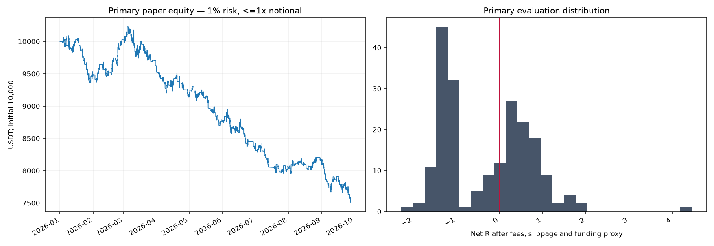
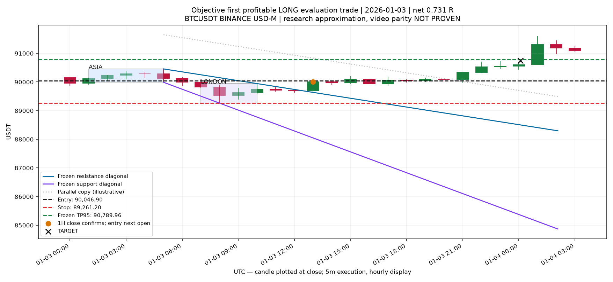
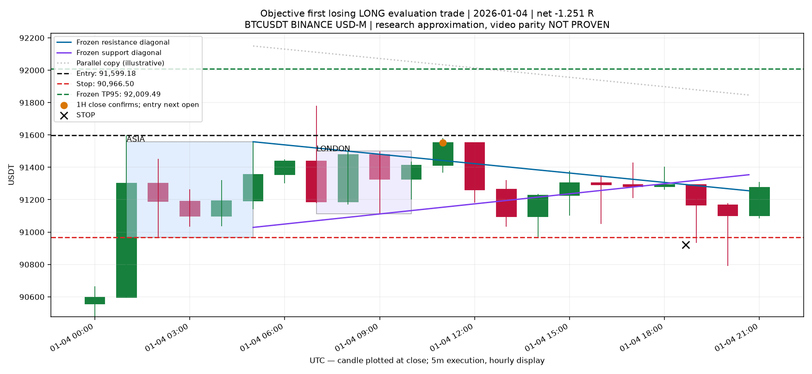
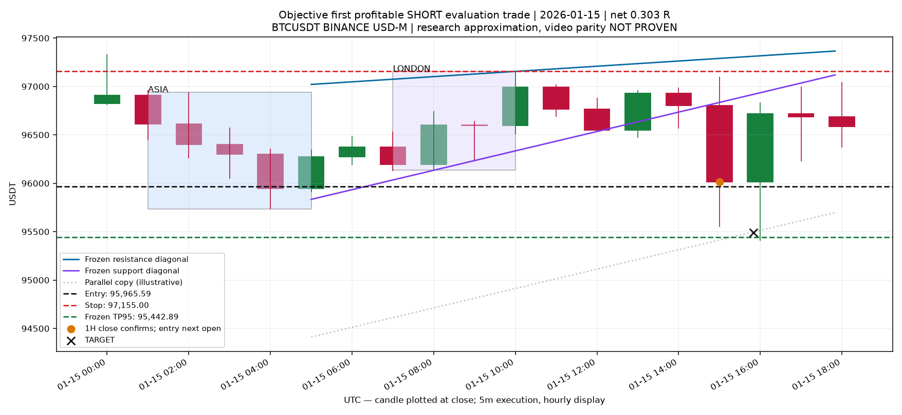
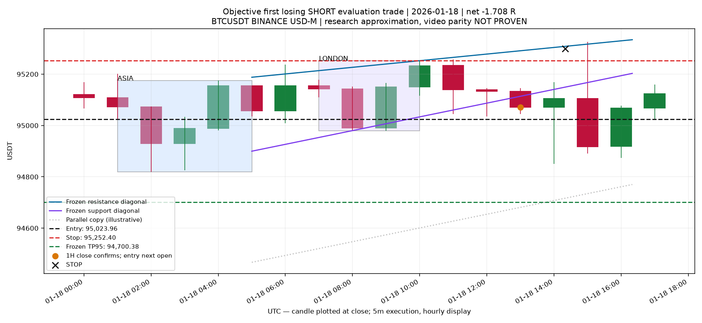

# I-GOD Kill Zones — research V0

**NO EDGE**. PAPER / SHADOW ONLY. TRADE AUTHORITY: NONE.

## What was tested and what was not

The original private Descript/Telegram links could not be opened. No transcript or diagonal anchor was independently viewed. The owner segment map is recorded in source_audit.json. **EXACT VIDEO DIAGONAL / PROJECTION PARITY: NOT PROVEN.** This result applies to two explicit geometry approximations, not a verified reproduction of the video. No quotations invented.

Protocol was committed before outcome computation: 5ccea82. The full specification and code/data lock are included. No parameter selection or rule change after evaluation.

## Data and temporal separation

| Field | Value |
|---|---|
| venue | BINANCE_USDM_PERPETUAL |
| symbol | BTCUSDT |
| first_open | 2023-09-01T00:00:00+00:00 |
| last_close | 2026-10-01T00:00:00+00:00 |
| rows_5m | 324288 |
| rows_1h | 27024 |
| funding_rows | 3378 |
| bars_sha256 | e62b7f7ef3ddf0a574d73b8f0630481b4e6a754a8990355c60c4be8403f4fa3e |
| hourly_sha256 | 923906a8b4aea6bcc1cb13d9a2faf0502c8464b049643b3de1603f0ccf3578de |
| funding_sha256 | 430ae9d26e474a049c467dbf9cc95cb11cdd9f2c96d10f4c8d32507b7bd81d0b |

No kline gaps or duplicates: 0 gap intervals. Complete-hour aggregation only. All 74 archive ZIPs are individually verified against official CHECKSUM files (manifest lists every URL/hash).

**NO VIRGIN HOLDOUT.** 2024 development, 2025 validation, Jan–Sep 2026 chronological evaluation; 2023 Sep–Dec is warmup. Price history has appeared in earlier research. 48h boundary embargo; 24h maximum holding; one position per model. This is historical research, not prospectively observed performance.

## Causal mechanics and ambiguities

Asia [20:00,00:00), previous local date; London [02:00,05:00). Primary IANA New York; fixed UTC−4 is a separate comparator. On spring DST Sunday London contains 2 physical hours. No fabricated hourly bar. Session highs/lows are frozen after London closes.

EXTREME_TIMES joins same-side extrema at their first hourly close timestamps; BOX_ENDS joins those prices at session endpoints. RANGE uses horizontal combined high/low. Only a fully closed hourly crossing confirms; a wick does not. Crossed/degenerate channels cannot confirm. A diagonal drifting across unchanged price is retained and flagged, not filtered after seeing outcomes.

Parallel-copy target = diagonal value at confirmation ± frozen combined range width, or measured horizontal range for RANGE. TP95 freezes 95% of the signal-close-to-target distance. This is an explicitly unverified translation convention. Stop is the opposite frozen range edge; entry next real hour open with adverse slippage; no repainting or future pivots.

## Costs and execution realism

Base: 0.06% commission plus 0.05% adverse slippage EACH leg; stress: 0.06% plus 0.10% EACH leg. All target exits pay taker costs too. These are assumptions, not verified fee-tier or Bitunix execution.

Funding uses real archived signed rates and timestamps, with last CLOSED 5m trade price as a settlement-mark proxy. Raw funding timestamps are preserved; observed offsets reach 26ms. There is one record per expected 8h bin and no funding-bin gap. Rates are not interpolated. Exact-at-entry favorable funding credits are excluded. Exact settlement marks and future live funding remain unknown.

5m stop/target collisions resolve stop-first. Stop gaps fill at worse open; target gaps give no favorable price improvement. MAE/MFE are conservative lower bounds from completed pre-exit bars plus exit fill; unknown exit-bar peaks are not counted. Drawdown uses 5m-close mark-to-market and realized exits, not only closed winners. Paper sizing includes stop cost reserve, capped at 1x notional.

## All twelve predeclared variants

| Model | Split | n | Win % | Mean net R | 95% block CI | PF | TP % | Net % | DD % | Stress mean R | Classification |
|---|---|---|---|---|---|---|---|---|---|---|---|
| NY_EXTREME_TIMES_TP100 | DEVELOPMENT | 274 | 40.9 | -0.237 | [-0.445, 0.017] | 0.662 | 40.1 | -37.04 | 38.62 | -0.359 | NOT A SELECTION STAGE |
| NY_EXTREME_TIMES_TP100 | VALIDATION | 269 | 38.7 | -1.005 | [-2.020, -0.343] | 0.266 | 36.4 | -36.77 | 37.90 | -0.562 | NOT A SELECTION STAGE |
| NY_EXTREME_TIMES_TP100 | EVALUATION | 202 | 45.5 | -0.277 | [-0.443, -0.109] | 0.544 | 43.6 | -23.08 | 25.51 | -0.363 | NO EDGE |
| NY_EXTREME_TIMES_TP95 | DEVELOPMENT | 274 | 40.9 | -0.258 | [-0.458, -0.016] | 0.631 | 40.9 | -38.82 | 40.28 | -0.376 | NOT A SELECTION STAGE |
| NY_EXTREME_TIMES_TP95 | VALIDATION | 269 | 39.4 | -1.005 | [-2.021, -0.339] | 0.261 | 37.9 | -36.74 | 38.53 | -0.566 | NOT A SELECTION STAGE |
| NY_EXTREME_TIMES_TP95 | EVALUATION | 203 | 45.8 | -0.293 | [-0.456, -0.132] | 0.516 | 44.3 | -24.95 | 26.61 | -0.372 | NO EDGE |
| NY_BOX_ENDS_TP100 | DEVELOPMENT | 308 | 41.6 | -0.223 | [-0.409, 0.018] | 0.664 | 38.3 | -46.33 | 47.37 | -0.344 | NOT A SELECTION STAGE |
| NY_BOX_ENDS_TP100 | VALIDATION | 305 | 41.3 | -0.415 | [-0.716, -0.203] | 0.485 | 38.0 | -33.99 | 39.85 | -0.423 | NOT A SELECTION STAGE |
| NY_BOX_ENDS_TP100 | EVALUATION | 228 | 47.8 | -0.195 | [-0.363, -0.027] | 0.654 | 45.2 | -21.39 | 27.39 | -0.286 | NO EDGE |
| NY_BOX_ENDS_TP95 | DEVELOPMENT | 308 | 42.9 | -0.214 | [-0.392, 0.013] | 0.671 | 40.3 | -44.96 | 45.98 | -0.334 | NOT A SELECTION STAGE |
| NY_BOX_ENDS_TP95 | VALIDATION | 306 | 41.5 | -0.428 | [-0.733, -0.217] | 0.467 | 39.2 | -35.79 | 40.61 | -0.435 | NOT A SELECTION STAGE |
| NY_BOX_ENDS_TP95 | EVALUATION | 229 | 48.9 | -0.200 | [-0.359, -0.043] | 0.641 | 47.6 | -22.22 | 27.50 | -0.285 | NO EDGE |
| NY_RANGE_TP100 | DEVELOPMENT | 238 | 51.3 | -0.149 | [-0.239, -0.060] | 0.625 | 47.9 | -27.04 | 28.34 | -0.199 | NOT A SELECTION STAGE |
| NY_RANGE_TP100 | VALIDATION | 230 | 53.5 | -0.156 | [-0.253, -0.060] | 0.598 | 48.3 | -27.67 | 29.98 | -0.214 | NOT A SELECTION STAGE |
| NY_RANGE_TP100 | EVALUATION | 174 | 55.2 | -0.135 | [-0.225, -0.046] | 0.631 | 49.4 | -16.22 | 18.00 | -0.192 | NO EDGE |
| NY_RANGE_TP95 | DEVELOPMENT | 239 | 51.9 | -0.155 | [-0.244, -0.066] | 0.606 | 48.5 | -28.05 | 29.19 | -0.205 | NOT A SELECTION STAGE |
| NY_RANGE_TP95 | VALIDATION | 231 | 54.1 | -0.164 | [-0.255, -0.073] | 0.577 | 49.8 | -28.65 | 30.74 | -0.222 | NOT A SELECTION STAGE |
| NY_RANGE_TP95 | EVALUATION | 175 | 57.1 | -0.112 | [-0.198, -0.030] | 0.671 | 52.0 | -13.46 | 16.07 | -0.171 | NO EDGE |
| UTC4_EXTREME_TIMES_TP100 | DEVELOPMENT | 272 | 41.2 | -0.210 | [-0.420, 0.050] | 0.703 | 39.0 | -36.01 | 37.62 | -0.341 | NOT A SELECTION STAGE |
| UTC4_EXTREME_TIMES_TP100 | VALIDATION | 274 | 40.1 | -0.823 | [-1.768, -0.250] | 0.314 | 37.6 | -33.30 | 35.46 | -0.521 | NOT A SELECTION STAGE |
| UTC4_EXTREME_TIMES_TP100 | EVALUATION | 206 | 44.7 | -0.291 | [-0.433, -0.152] | 0.528 | 42.2 | -26.78 | 27.53 | -0.377 | NO EDGE |
| UTC4_EXTREME_TIMES_TP95 | DEVELOPMENT | 273 | 41.8 | -0.223 | [-0.421, 0.021] | 0.681 | 41.0 | -36.31 | 37.86 | -0.350 | NOT A SELECTION STAGE |
| UTC4_EXTREME_TIMES_TP95 | VALIDATION | 274 | 40.9 | -0.826 | [-1.772, -0.253] | 0.306 | 38.7 | -33.68 | 35.57 | -0.524 | NOT A SELECTION STAGE |
| UTC4_EXTREME_TIMES_TP95 | EVALUATION | 207 | 45.4 | -0.307 | [-0.444, -0.173] | 0.501 | 43.0 | -28.58 | 29.19 | -0.386 | NO EDGE |
| UTC4_BOX_ENDS_TP100 | DEVELOPMENT | 312 | 39.4 | -0.311 | [-0.439, -0.175] | 0.554 | 36.5 | -49.18 | 50.34 | -0.397 | NOT A SELECTION STAGE |
| UTC4_BOX_ENDS_TP100 | VALIDATION | 306 | 39.9 | -0.371 | [-0.479, -0.261] | 0.485 | 36.6 | -44.27 | 45.44 | -0.477 | NOT A SELECTION STAGE |
| UTC4_BOX_ENDS_TP100 | EVALUATION | 228 | 45.6 | -0.247 | [-0.395, -0.092] | 0.588 | 43.4 | -28.85 | 30.22 | -0.338 | NO EDGE |
| UTC4_BOX_ENDS_TP95 | DEVELOPMENT | 313 | 41.5 | -0.211 | [-0.399, 0.044] | 0.688 | 39.6 | -45.97 | 47.16 | -0.335 | NOT A SELECTION STAGE |
| UTC4_BOX_ENDS_TP95 | VALIDATION | 307 | 41.0 | -0.361 | [-0.469, -0.251] | 0.488 | 38.8 | -42.87 | 44.03 | -0.467 | NOT A SELECTION STAGE |
| UTC4_BOX_ENDS_TP95 | EVALUATION | 229 | 46.7 | -0.251 | [-0.394, -0.105] | 0.576 | 45.4 | -29.53 | 30.99 | -0.336 | NO EDGE |
| UTC4_RANGE_TP100 | DEVELOPMENT | 238 | 51.7 | -0.125 | [-0.207, -0.043] | 0.676 | 49.2 | -23.15 | 24.19 | -0.175 | NOT A SELECTION STAGE |
| UTC4_RANGE_TP100 | VALIDATION | 225 | 52.0 | -0.160 | [-0.253, -0.070] | 0.597 | 47.6 | -27.27 | 27.69 | -0.217 | NOT A SELECTION STAGE |
| UTC4_RANGE_TP100 | EVALUATION | 177 | 57.1 | -0.123 | [-0.212, -0.035] | 0.656 | 49.7 | -14.83 | 17.38 | -0.181 | NO EDGE |
| UTC4_RANGE_TP95 | DEVELOPMENT | 239 | 51.9 | -0.135 | [-0.216, -0.056] | 0.646 | 49.4 | -24.89 | 25.85 | -0.184 | NOT A SELECTION STAGE |
| UTC4_RANGE_TP95 | VALIDATION | 226 | 52.2 | -0.175 | [-0.265, -0.086] | 0.561 | 48.2 | -29.43 | 29.83 | -0.233 | NOT A SELECTION STAGE |
| UTC4_RANGE_TP95 | EVALUATION | 177 | 58.2 | -0.112 | [-0.197, -0.029] | 0.670 | 51.4 | -13.46 | 15.85 | -0.171 | NO EDGE |

Net % and drawdown are on the explicitly sized unlevered paper account, not an account-return promise.

## Incremental diagonal value vs matched horizontal range baseline

Paired daily net-R differences include zero-trade dates. Circular moving bootstrap: 14 calendar days, 5000 draws, fixed seed. The familywise interval is 99.5833% (twelve-cell Bonferroni). It is descriptive with dependent trials, not a proof of causality.

| Model | Daily R difference | 95% CI | Familywise CI |
|---|---|---|---|
| NY_EXTREME_TIMES_TP100 | -0.119 | [-0.2263, -0.0035] | [-0.275, 0.042] |
| NY_EXTREME_TIMES_TP95 | -0.146 | [-0.2557, -0.03] | [-0.3039, 0.0167] |
| NY_BOX_ENDS_TP100 | -0.077 | [-0.1999, 0.0495] | [-0.2507, 0.1021] |
| NY_BOX_ENDS_TP95 | -0.096 | [-0.2118, 0.0244] | [-0.2645, 0.0719] |
| NY_RANGE_TP100 | 0.000 | [0.0, 0.0] | [0.0, 0.0] |
| NY_RANGE_TP95 | 0.000 | [0.0, 0.0] | [0.0, 0.0] |
| UTC4_EXTREME_TIMES_TP100 | -0.140 | [-0.2276, -0.0529] | [-0.2662, -0.0084] |
| UTC4_EXTREME_TIMES_TP95 | -0.160 | [-0.2449, -0.0734] | [-0.2841, -0.0344] |
| UTC4_BOX_ENDS_TP100 | -0.126 | [-0.2352, -0.0143] | [-0.2806, 0.0351] |
| UTC4_BOX_ENDS_TP95 | -0.138 | [-0.2381, -0.0348] | [-0.2826, 0.009] |
| UTC4_RANGE_TP100 | 0.000 | [0.0, 0.0] | [0.0, 0.0] |
| UTC4_RANGE_TP95 | 0.000 | [0.0, 0.0] | [0.0, 0.0] |

## Primary candidate — distribution, costs and failures

| Metric | Evaluation |
|---|---|
| n | 203.0000 |
| long | 115.0000 |
| short | 88.0000 |
| mean_gross_r | -0.1362 |
| mean_net_r | -0.2932 |
| median_net_r | -0.1766 |
| p10_net_r | -1.3662 |
| p90_net_r | 0.9187 |
| profit_factor | 0.5164 |
| target_hit_rate | 0.4433 |
| ambiguous | 0.0000 |
| mean_mae_r | 0.7282 |
| mean_mfe_r | 0.6357 |
| mean_duration_hours | 7.4339 |
| exposure_fraction | 0.2303 |
| gross_pnl_usdt | -857.8340 |
| commissions_usdt | 1631.3466 |
| slippage_usdt | 1359.4556 |
| funding_proxy_usdt | -6.0643 |
| net_pnl_usdt | -2495.2448 |
| ex_best1_mean_r | -0.3167 |
| ex_best3_mean_r | -0.3398 |

Gross PnL uses simulated fills (already includes slippage); net subtracts commissions and adds signed funding. The separate slippage total is diagnostic and is not deducted twice. Adverse outcomes are never manually removed.

## Long/short, temporal stability and best-event sensitivity

| Model | Slice | n | Mean net R | Median | PF |
|---|---|---|---|---|---|
| NY_EXTREME_TIMES_TP100 | 2024 | 274 | -0.237 | -1.059 | 0.662 |
| NY_EXTREME_TIMES_TP100 | 2025 | 269 | -1.005 | -1.087 | 0.266 |
| NY_EXTREME_TIMES_TP100 | 2026 | 202 | -0.277 | -0.181 | 0.544 |
| NY_EXTREME_TIMES_TP100 | LONG | 115 | -0.268 | -0.150 | 0.546 |
| NY_EXTREME_TIMES_TP100 | SHORT | 87 | -0.289 | -0.326 | 0.543 |
| NY_EXTREME_TIMES_TP100 | WEEKDAY | 149 | -0.202 | -0.097 | 0.632 |
| NY_EXTREME_TIMES_TP100 | WEEKEND | 53 | -0.487 | -1.109 | 0.368 |
| NY_EXTREME_TIMES_TP100 | 2026_H1 | 136 | -0.237 | -0.149 | 0.590 |
| NY_EXTREME_TIMES_TP100 | 2026_H2 | 66 | -0.359 | -0.630 | 0.464 |
| NY_EXTREME_TIMES_TP95 | 2024 | 274 | -0.258 | -1.058 | 0.631 |
| NY_EXTREME_TIMES_TP95 | 2025 | 269 | -1.005 | -1.082 | 0.261 |
| NY_EXTREME_TIMES_TP95 | 2026 | 203 | -0.293 | -0.177 | 0.516 |
| NY_EXTREME_TIMES_TP95 | LONG | 115 | -0.277 | -0.118 | 0.526 |
| NY_EXTREME_TIMES_TP95 | SHORT | 88 | -0.314 | -0.363 | 0.505 |
| NY_EXTREME_TIMES_TP95 | WEEKDAY | 150 | -0.217 | -0.021 | 0.604 |
| NY_EXTREME_TIMES_TP95 | WEEKEND | 53 | -0.509 | -1.109 | 0.341 |
| NY_EXTREME_TIMES_TP95 | 2026_H1 | 136 | -0.255 | -0.149 | 0.558 |
| NY_EXTREME_TIMES_TP95 | 2026_H2 | 67 | -0.371 | -0.612 | 0.444 |
| NY_BOX_ENDS_TP100 | 2024 | 308 | -0.223 | -1.049 | 0.664 |
| NY_BOX_ENDS_TP100 | 2025 | 305 | -0.415 | -1.053 | 0.485 |
| NY_BOX_ENDS_TP100 | 2026 | 228 | -0.195 | -0.112 | 0.654 |
| NY_BOX_ENDS_TP100 | LONG | 121 | -0.232 | -0.174 | 0.593 |
| NY_BOX_ENDS_TP100 | SHORT | 107 | -0.154 | 0.101 | 0.725 |
| NY_BOX_ENDS_TP100 | WEEKDAY | 165 | -0.143 | 0.001 | 0.725 |
| NY_BOX_ENDS_TP100 | WEEKEND | 63 | -0.331 | -1.094 | 0.510 |
| NY_BOX_ENDS_TP100 | 2026_H1 | 155 | -0.153 | -0.071 | 0.714 |
| NY_BOX_ENDS_TP100 | 2026_H2 | 73 | -0.286 | -0.513 | 0.546 |
| NY_BOX_ENDS_TP95 | 2024 | 308 | -0.214 | -1.045 | 0.671 |
| NY_BOX_ENDS_TP95 | 2025 | 306 | -0.428 | -1.051 | 0.467 |
| NY_BOX_ENDS_TP95 | 2026 | 229 | -0.200 | -0.025 | 0.641 |
| NY_BOX_ENDS_TP95 | LONG | 121 | -0.242 | -0.163 | 0.571 |
| NY_BOX_ENDS_TP95 | SHORT | 108 | -0.154 | 0.152 | 0.721 |
| NY_BOX_ENDS_TP95 | WEEKDAY | 166 | -0.160 | 0.034 | 0.692 |
| NY_BOX_ENDS_TP95 | WEEKEND | 63 | -0.306 | -0.513 | 0.533 |
| NY_BOX_ENDS_TP95 | 2026_H1 | 155 | -0.165 | -0.025 | 0.690 |
| NY_BOX_ENDS_TP95 | 2026_H2 | 74 | -0.274 | -0.089 | 0.551 |
| NY_RANGE_TP100 | 2024 | 238 | -0.149 | 0.110 | 0.625 |
| NY_RANGE_TP100 | 2025 | 230 | -0.156 | 0.082 | 0.598 |
| NY_RANGE_TP100 | 2026 | 174 | -0.135 | 0.059 | 0.631 |
| NY_RANGE_TP100 | LONG | 90 | -0.170 | 0.044 | 0.554 |
| NY_RANGE_TP100 | SHORT | 84 | -0.097 | 0.128 | 0.721 |
| NY_RANGE_TP100 | WEEKDAY | 132 | -0.054 | 0.136 | 0.827 |
| NY_RANGE_TP100 | WEEKEND | 42 | -0.389 | -0.112 | 0.271 |
| NY_RANGE_TP100 | 2026_H1 | 113 | -0.140 | 0.051 | 0.614 |
| NY_RANGE_TP100 | 2026_H2 | 61 | -0.125 | 0.165 | 0.662 |
| NY_RANGE_TP95 | 2024 | 239 | -0.155 | 0.112 | 0.606 |
| NY_RANGE_TP95 | 2025 | 231 | -0.164 | 0.096 | 0.577 |
| NY_RANGE_TP95 | 2026 | 175 | -0.112 | 0.091 | 0.671 |
| NY_RANGE_TP95 | LONG | 90 | -0.137 | 0.056 | 0.610 |
| NY_RANGE_TP95 | SHORT | 85 | -0.086 | 0.141 | 0.739 |
| NY_RANGE_TP95 | WEEKDAY | 132 | -0.023 | 0.160 | 0.917 |
| NY_RANGE_TP95 | WEEKEND | 43 | -0.386 | -0.104 | 0.262 |
| NY_RANGE_TP95 | 2026_H1 | 114 | -0.122 | 0.075 | 0.646 |
| NY_RANGE_TP95 | 2026_H2 | 61 | -0.095 | 0.162 | 0.718 |
| UTC4_EXTREME_TIMES_TP100 | 2024 | 272 | -0.210 | -1.054 | 0.703 |
| UTC4_EXTREME_TIMES_TP100 | 2025 | 274 | -0.823 | -1.073 | 0.314 |
| UTC4_EXTREME_TIMES_TP100 | 2026 | 206 | -0.291 | -0.224 | 0.528 |
| UTC4_EXTREME_TIMES_TP100 | LONG | 119 | -0.288 | -0.170 | 0.528 |
| UTC4_EXTREME_TIMES_TP100 | SHORT | 87 | -0.295 | -0.326 | 0.528 |
| UTC4_EXTREME_TIMES_TP100 | WEEKDAY | 149 | -0.261 | -0.155 | 0.550 |
| UTC4_EXTREME_TIMES_TP100 | WEEKEND | 57 | -0.370 | -1.109 | 0.480 |
| UTC4_EXTREME_TIMES_TP100 | 2026_H1 | 140 | -0.259 | -0.182 | 0.562 |
| UTC4_EXTREME_TIMES_TP100 | 2026_H2 | 66 | -0.359 | -0.630 | 0.464 |
| UTC4_EXTREME_TIMES_TP95 | 2024 | 273 | -0.223 | -1.050 | 0.681 |
| UTC4_EXTREME_TIMES_TP95 | 2025 | 274 | -0.826 | -0.915 | 0.306 |
| UTC4_EXTREME_TIMES_TP95 | 2026 | 207 | -0.307 | -0.194 | 0.501 |
| UTC4_EXTREME_TIMES_TP95 | LONG | 119 | -0.297 | -0.170 | 0.509 |
| UTC4_EXTREME_TIMES_TP95 | SHORT | 88 | -0.321 | -0.363 | 0.491 |
| UTC4_EXTREME_TIMES_TP95 | WEEKDAY | 150 | -0.274 | -0.141 | 0.526 |
| UTC4_EXTREME_TIMES_TP95 | WEEKEND | 57 | -0.394 | -1.109 | 0.447 |
| UTC4_EXTREME_TIMES_TP95 | 2026_H1 | 140 | -0.277 | -0.182 | 0.532 |
| UTC4_EXTREME_TIMES_TP95 | 2026_H2 | 67 | -0.371 | -0.612 | 0.444 |
| UTC4_BOX_ENDS_TP100 | 2024 | 312 | -0.311 | -1.057 | 0.554 |
| UTC4_BOX_ENDS_TP100 | 2025 | 306 | -0.371 | -1.090 | 0.485 |
| UTC4_BOX_ENDS_TP100 | 2026 | 228 | -0.247 | -0.290 | 0.588 |
| UTC4_BOX_ENDS_TP100 | LONG | 123 | -0.308 | -0.612 | 0.500 |
| UTC4_BOX_ENDS_TP100 | SHORT | 105 | -0.175 | -0.071 | 0.698 |
| UTC4_BOX_ENDS_TP100 | WEEKDAY | 166 | -0.191 | -0.151 | 0.663 |
| UTC4_BOX_ENDS_TP100 | WEEKEND | 62 | -0.395 | -1.100 | 0.420 |
| UTC4_BOX_ENDS_TP100 | 2026_H1 | 155 | -0.228 | -0.255 | 0.609 |
| UTC4_BOX_ENDS_TP100 | 2026_H2 | 73 | -0.286 | -0.513 | 0.546 |
| UTC4_BOX_ENDS_TP95 | 2024 | 313 | -0.211 | -1.050 | 0.688 |
| UTC4_BOX_ENDS_TP95 | 2025 | 307 | -0.361 | -1.080 | 0.488 |
| UTC4_BOX_ENDS_TP95 | 2026 | 229 | -0.251 | -0.194 | 0.576 |
| UTC4_BOX_ENDS_TP95 | LONG | 123 | -0.317 | -0.513 | 0.480 |
| UTC4_BOX_ENDS_TP95 | SHORT | 106 | -0.174 | 0.078 | 0.694 |
| UTC4_BOX_ENDS_TP95 | WEEKDAY | 167 | -0.207 | -0.128 | 0.633 |
| UTC4_BOX_ENDS_TP95 | WEEKEND | 62 | -0.368 | -0.804 | 0.442 |
| UTC4_BOX_ENDS_TP95 | 2026_H1 | 155 | -0.240 | -0.255 | 0.588 |
| UTC4_BOX_ENDS_TP95 | 2026_H2 | 74 | -0.274 | -0.089 | 0.551 |
| UTC4_RANGE_TP100 | 2024 | 238 | -0.125 | 0.135 | 0.676 |
| UTC4_RANGE_TP100 | 2025 | 225 | -0.160 | 0.083 | 0.597 |
| UTC4_RANGE_TP100 | 2026 | 177 | -0.123 | 0.123 | 0.656 |
| UTC4_RANGE_TP100 | LONG | 94 | -0.188 | 0.055 | 0.526 |
| UTC4_RANGE_TP100 | SHORT | 83 | -0.049 | 0.180 | 0.843 |
| UTC4_RANGE_TP100 | WEEKDAY | 134 | -0.049 | 0.167 | 0.841 |
| UTC4_RANGE_TP100 | WEEKEND | 43 | -0.354 | -0.026 | 0.310 |
| UTC4_RANGE_TP100 | 2026_H1 | 116 | -0.122 | 0.118 | 0.653 |
| UTC4_RANGE_TP100 | 2026_H2 | 61 | -0.125 | 0.165 | 0.662 |
| UTC4_RANGE_TP95 | 2024 | 239 | -0.135 | 0.128 | 0.646 |
| UTC4_RANGE_TP95 | 2025 | 226 | -0.175 | 0.091 | 0.561 |
| UTC4_RANGE_TP95 | 2026 | 177 | -0.112 | 0.116 | 0.670 |
| UTC4_RANGE_TP95 | LONG | 94 | -0.173 | 0.077 | 0.540 |
| UTC4_RANGE_TP95 | SHORT | 83 | -0.044 | 0.184 | 0.853 |
| UTC4_RANGE_TP95 | WEEKDAY | 134 | -0.030 | 0.170 | 0.894 |
| UTC4_RANGE_TP95 | WEEKEND | 43 | -0.368 | -0.053 | 0.283 |
| UTC4_RANGE_TP95 | 2026_H1 | 116 | -0.121 | 0.114 | 0.644 |
| UTC4_RANGE_TP95 | 2026_H2 | 61 | -0.095 | 0.162 | 0.718 |

| Model | Ex best 1 mean R | Ex best 3 mean R | Line-drift-only trades | Evaluation ambiguous exits |
|---|---|---|---|---|
| NY_EXTREME_TIMES_TP100 | -0.302 | -0.326 | 6 | 0 |
| NY_EXTREME_TIMES_TP95 | -0.317 | -0.340 | 6 | 0 |
| NY_BOX_ENDS_TP100 | -0.215 | -0.247 | 8 | 0 |
| NY_BOX_ENDS_TP95 | -0.219 | -0.250 | 8 | 0 |
| NY_RANGE_TP100 | -0.141 | -0.152 | 0 | 0 |
| NY_RANGE_TP95 | -0.118 | -0.128 | 0 | 0 |
| UTC4_EXTREME_TIMES_TP100 | -0.303 | -0.326 | 6 | 0 |
| UTC4_EXTREME_TIMES_TP95 | -0.318 | -0.340 | 6 | 0 |
| UTC4_BOX_ENDS_TP100 | -0.267 | -0.298 | 11 | 0 |
| UTC4_BOX_ENDS_TP95 | -0.270 | -0.300 | 11 | 0 |
| UTC4_RANGE_TP100 | -0.129 | -0.140 | 0 | 0 |
| UTC4_RANGE_TP95 | -0.118 | -0.128 | 0 | 0 |

## Frozen indicator complementarity — descriptive ablations only

Only the predeclared primary geometry/clock/target is filtered. AO slope is direction/momentum; ADX slope is strength only and DMI supplies side. Existing formulas are imported read-only from frozen code. Konkorde remains KONKORDE_PROXY; **EXACT BITMAN KONKORDE PARITY: NOT PROVEN**. Higher-timeframe features use only already closed 4H/1D bars and are descriptive, not new fitted conditions.

| Filter | Split | Trades | Removed vs ALL | Mean net R | 95% CI | PF |
|---|---|---|---|---|---|---|
| ALL | DEVELOPMENT | 274 | 0 | -0.258 | [-0.458, -0.016] | 0.631 |
| ALL | VALIDATION | 269 | 0 | -1.005 | [-2.021, -0.339] | 0.261 |
| ALL | EVALUATION | 203 | 0 | -0.293 | [-0.456, -0.132] | 0.516 |
| AO | DEVELOPMENT | 163 | 111 | -0.215 | [-0.376, -0.042] | 0.595 |
| AO | VALIDATION | 164 | 105 | -0.300 | [-0.488, -0.12] | 0.504 |
| AO | EVALUATION | 142 | 61 | -0.203 | [-0.346, -0.082] | 0.592 |
| DMI_ADX | DEVELOPMENT | 77 | 197 | -0.176 | [-0.369, 0.022] | 0.613 |
| DMI_ADX | VALIDATION | 80 | 189 | -0.165 | [-0.362, 0.027] | 0.623 |
| DMI_ADX | EVALUATION | 69 | 134 | -0.092 | [-0.271, 0.073] | 0.751 |
| KONKORDE_PROXY | DEVELOPMENT | 128 | 146 | -0.221 | [-0.347, -0.084] | 0.563 |
| KONKORDE_PROXY | VALIDATION | 135 | 134 | -0.239 | [-0.383, -0.098] | 0.525 |
| KONKORDE_PROXY | EVALUATION | 114 | 89 | -0.140 | [-0.255, -0.041] | 0.658 |
| AO_DMI_KONKORDE | DEVELOPMENT | 47 | 227 | -0.289 | [-0.49, -0.081] | 0.401 |
| AO_DMI_KONKORDE | VALIDATION | 55 | 214 | -0.217 | [-0.429, -0.003] | 0.489 |
| AO_DMI_KONKORDE | EVALUATION | 50 | 153 | -0.099 | [-0.26, 0.057] | 0.706 |

**ML RSI: UNAVAILABLE FOR INCREMENTAL EVALUATION.** The real confirmed export covers October 2026, after this cutoff. No historical ML RSI was reconstructed, no classical RSI substitution and no fabricated confirmed events. No result here establishes incremental confirmed ML RSI value.

## Rejections and coverage

| Reason | Count |
|---|---|
| ENTRY_AT_OR_BEYOND_STOP | 48 |
| ENTRY_AT_OR_BEYOND_TARGET | 178 |
| OVERLAPPING_POSITION | 489 |

Session construction diagnostics: {}. Counts aggregate variants and are not independent trading days. All raw candidates, fills and rejected reasons are retained locally; versioned trades.csv contains every completed trade, including losers.

## Objective examples — winners AND losers

Chosen by first chronological evaluation trade in each primary LONG/SHORT × profitable/losing cell. Never used to tune rules. Available_at is the completed 1H close; entry uses the subsequent open (same boundary timestamp, after close).

| UTC confirmation | Side | Entry | Stop | TP | Net R | Exit |
|---|---|---|---|---|---|---|
| 2026-01-03T13:00:00+00:00 | LONG | 90046.90 | 89261.20 | 90789.96 | 0.731 | TARGET |
| 2026-01-04T11:00:00+00:00 | LONG | 91599.18 | 90966.50 | 92009.49 | -1.251 | STOP |
| 2026-01-15T15:00:00+00:00 | SHORT | 95965.59 | 97155.00 | 95442.89 | 0.303 | TARGET |
| 2026-01-18T13:00:00+00:00 | SHORT | 95023.96 | 95252.40 | 94700.38 | -1.708 | STOP |

## Limitations and decision

Classification criteria were fixed before outcomes: PROMISING needs positive evaluation CI, validation/stress/half-year/ex-best-3 stability, adequate LONG/SHORT counts and corrected paired improvement vs RANGE. NO EDGE is a nonpositive net mean with PF≤1 or a nonpositive upper CI; otherwise INCONCLUSIVE (n<30 always insufficient). All cells are shown; no best geometry/clock/target is selected.

**NO EDGE**. The exact video rule remains untested until visual anchors/translation are available. No runtime, Guardian V2, V8, ML RSI, operability, weekly V1, Railway or Telegram changes. No strategy activation or orders. Any continuation requires a new forward research protocol and independent review.

Reproduce: install research/kill_zones/requirements.txt; python -m research.kill_zones.data --download --cache research/cache/kill_zones_public; python -m research.kill_zones.study run --cache research/cache/kill_zones_public. Use the published lock; do not overwrite it to fit altered inputs.
